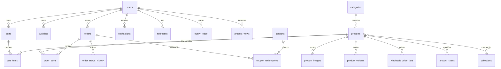

# Jewellery B2B — Backend Design (.NET + PostgreSQL)

Ground truth for this design is the Flutter client in `ecommerce_app/`: every
entity, rule and state machine below is derived from the shipped models
(`product.dart`, `models/order.dart`, `models/coupon.dart`, `models/cms.dart`,
`models/user.dart`, `pricing.dart`, `business_config.dart`, `commerce_store.dart`)
so the API fits the app as approved — no client rewrite, only a transport swap.

---

## 1. Stack

| Concern | Choice | Why |
|---|---|---|
| Runtime | **.NET 10 (LTS)** | Current LTS (Nov 2025 → Nov 2028); long support window for a commerce platform |
| Web | ASP.NET Core MVC **Controllers** + Service layer | CRUD-heavy console benefits from controller conventions + filters; Swagger maps cleanly |
| ORM | **EF Core 10** + Npgsql | Compiled queries, split/bulk ops, migrations |
| Primary DB | **PostgreSQL 17** | JSONB (store config/specs), arrays (occasions/images), full-text + trigram search, rock-solid row-level locking for stock |
| Cache / hot state | **Redis 8** | Catalog response cache, rate-limit counters, cart session mirror |
| Realtime | **SignalR** | Matches client `RealtimeService` (order status, notifications, stock) |
| Identity | ASP.NET Core **Identity** + JWT (access 15 min / rotating refresh 30 d) | Password hashing, lockout, token rotation done right |
| Object storage | **MinIO** (dev) / **S3** (prod) | Product media; server renders size variants (see §10) |
| Background | **Hangfire** (Postgres storage) | Coupon windows, notification fan-out, outbox dispatch, daily rates |
| Validation | FluentValidation | Request DTO validation |
| Errors | RFC 7807 `ProblemDetails` | Uniform error contract |
| Logs | Serilog → console + file/Seq | Structured, request-scoped |
| Tests | xUnit + Testcontainers (Postgres) + FluentAssertions | Integration tests against a real DB |

Money rule: **`BIGINT` whole rupees** — the client contract and GST maths are
integer rupees (`Pricing.money`, `tax()` rounds to rupee); paise would add
conversion noise for zero product benefit here. Revisit only if the platform
goes multi-currency with minor units.

---

## 2. Architecture

Modular monolith, Clean Architecture split — start as one deployable, keep
module boundaries strict so a hot module (catalog) can split later.

```
backend/
├── src/
│   ├── JewelryB2B.Api/            # Controllers, SignalR hubs, middleware,
│   │                              # DI wiring, Swagger, Serilog bootstrap
│   ├── JewelryB2B.Application/    # Services, DTOs, validators, mappings,
│   │                              # interfaces (IAppDbContext, ICache, IStorage)
│   ├── JewelryB2B.Domain/         # Entities, enums, PricingEngine,
│   │                              # OrderStateMachine, domain events
│   └── JewelryB2B.Infrastructure/ # EF Core + migrations, Identity, Redis,
│                                  # S3/MinIO, Hangfire, outbox dispatcher
├── tests/
│   ├── JewelryB2B.UnitTests/      # PricingEngine, state machine, validators
│   └── JewelryB2B.IntegrationTests/  # WebApplicationFactory + Testcontainers
└── deploy/
    ├── docker-compose.yml         # api + postgres + redis + minio + hangfire
    ├── Dockerfile
    └── .env.example
```

Dependency rule: `Api → Application → Domain ← Infrastructure`.
Domain has **no** EF/HTTP types; Infrastructure implements Application
interfaces. Module folders inside each project: `Catalog`, `Cart`, `Orders`,
`Identity`, `Coupons`, `Notifications`, `StoreConfig`, `Media`, `Loyalty`.

---

## 3. Domain model (ER)



---

## 4. Schema (PostgreSQL)

Conventions: `id uuid primary key` (UUIDv7 — time-ordered, index-friendly),
`created_at timestamptz not null default now()`, soft delete via
`is_deleted boolean` on catalogue rows. Enums as native PG enums.

### 4.1 Identity

```sql
create table tenants (
  id uuid primary key,
  name text not null,
  business_type text not null,          -- 'jewellery' | 'fashion' | ...
  created_at timestamptz not null default now()
);

create type user_role as enum ('customer', 'owner', 'admin');

create table users (
  id uuid primary key,
  tenant_id uuid not null references tenants,
  name text not null,
  email citext not null,
  phone text not null,
  password_hash text not null,          -- Identity V3 hasher
  role user_role not null,
  shop_name text,                       -- owners only
  loyalty_points integer not null default 0,
  is_active boolean not null default true,
  created_at timestamptz not null default now(),
  updated_at timestamptz not null default now(),
  unique (tenant_id, email),
  unique (tenant_id, phone)
);

create table refresh_tokens (
  id uuid primary key,
  user_id uuid not null references users on delete cascade,
  token_hash text not null unique,      -- only the hash is stored
  expires_at timestamptz not null,
  revoked_at timestamptz,
  created_ip inet
);
create index on refresh_tokens (user_id) where revoked_at is null;

create table addresses (
  id uuid primary key,
  user_id uuid not null references users on delete cascade,
  label text, line1 text not null, line2 text,
  city text not null, state text not null, pincode text not null,
  is_default boolean not null default false
);
```

### 4.2 Catalog

```sql
create table categories (
  id uuid primary key,
  tenant_id uuid not null references tenants,
  name text not null,
  slug text not null,
  icon_emoji text,                      -- client fallback glyph whitelist
  display_order int not null default 0,
  is_visible boolean not null default true,
  unique (tenant_id, slug)
);

create table brands (                    -- normalised; client still gets a string
  id uuid primary key,
  tenant_id uuid not null references tenants,
  name text not null,
  slug text not null,
  unique (tenant_id, slug)
);

create table products (
  id uuid primary key,
  tenant_id uuid not null references tenants,
  owner_id uuid references users,       -- null ⇒ platform stock (matches ownerId == '')
  name text not null,
  slug text not null,
  seo_title text not null default '',
  brand_id uuid not null references brands,
  category_id uuid not null references categories,
  sku text not null,
  description text not null default '',
  price bigint not null,                -- ₹, unit price (pre-tier)
  price_usd bigint not null default 0,  -- dual-currency display, 0 = unset
  mrp bigint not null,
  stock integer not null default 0,
  minimum_order_quantity integer not null default 1,
  in_stock boolean not null default true,
  delivery_days integer not null default 3,
  family text not null default '',
  style text not null default '',
  metal text not null default '',       -- Taxonomy.metals values
  purity text not null default '',
  audience text not null default '',
  occasions text[] not null default '{}',
  is_verified_supplier boolean not null default false,
  rating numeric(2,1) not null default 0,   -- denormalised from reviews
  review_count integer not null default 0,
  is_deleted boolean not null default false,
  created_at timestamptz not null default now(),
  updated_at timestamptz not null default now(),
  search_vector tsvector generated always as (
    to_tsvector('simple', coalesce(name,'') || ' ' || coalesce(sku,'') ||
                ' ' || coalesce(description,''))
  ) stored,
  unique (tenant_id, sku)
);
create index ix_products_category on products (category_id) where not is_deleted;
create index ix_products_owner on products (owner_id) where not is_deleted;
create index ix_products_slug on products (tenant_id, slug);
create index ix_products_metal on products (tenant_id, metal) where not is_deleted;
create index ix_products_created on products (tenant_id, created_at desc);
create index ix_products_search on products using gin (search_vector);
create index ix_products_occasions on products using gin (occasions);

create table product_images (
  id uuid primary key,
  product_id uuid not null references products on delete cascade,
  storage_key text not null,            -- original object key
  url text not null,                    -- public CDN/base URL
  position int not null default 0,
  alt text not null default ''
);
create index on product_images (product_id, position);

create table product_variants (
  id uuid primary key,
  product_id uuid not null references products on delete cascade,
  kind text not null check (kind in ('size','shade')),
  name text not null,
  swatch_hex text,                      -- null for size chips
  position int not null default 0
);

create table wholesale_price_tiers (
  id uuid primary key,
  product_id uuid not null references products on delete cascade,
  minimum_quantity int not null,
  unit_price bigint not null
);
create unique index on wholesale_price_tiers (product_id, minimum_quantity);

create table product_specs (            -- keys come from business productFields
  id uuid primary key,
  product_id uuid not null references products on delete cascade,
  field_key text not null,              -- 'Gold Purity', 'Gross Weight', ...
  field_value text not null,
  position int not null default 0
);

create table collections (
  id uuid primary key,
  tenant_id uuid not null references tenants,
  name text not null,
  slug text not null,
  route text not null default '',
  image_url text not null default '',
  visible boolean not null default true,
  position int not null default 0,
  unique (tenant_id, slug)
);

create table collection_products (
  collection_id uuid not null references collections on delete cascade,
  product_id uuid not null references products on delete cascade,
  position int not null default 0,
  primary key (collection_id, product_id)
);

create table reviews (
  id uuid primary key,
  product_id uuid not null references products on delete cascade,
  user_id uuid not null references users,
  rating int not null check (rating between 1 and 5),
  title text not null default '',
  body text not null default '',
  status text not null default 'published'
        check (status in ('pending','published','rejected')),
  created_at timestamptz not null default now(),
  unique (product_id, user_id)
);

create table product_views (            -- drives TrendingRail (30-day window)
  id uuid primary key,
  product_id uuid not null references products on delete cascade,
  user_id uuid references users on delete set null,
  session_key text,                     -- anonymous viewers
  viewed_at timestamptz not null default now()
);
create index on product_views (product_id, viewed_at);
```

### 4.3 Cart & Orders

```sql
create table carts (
  id uuid primary key,
  user_id uuid not null unique references users on delete cascade,
  coupon_code text,                     -- applied coupon (revalidated on read)
  updated_at timestamptz not null default now()
);

create table cart_items (
  id uuid primary key,
  cart_id uuid not null references carts on delete cascade,
  product_id uuid not null references products,
  quantity int not null check (quantity > 0),
  selected_size text,
  selected_shade text
);
-- one line per product+size+shade (client lineKey rule)
create unique index on cart_items
  (cart_id, product_id, coalesce(selected_size,''), coalesce(selected_shade,''));

create type order_status as enum
  ('placed','confirmed','packed','shipped','out_for_delivery',
   'delivered','cancelled','returned');

create table orders (
  id uuid primary key,
  order_number text not null unique,    -- 'ORD-2026-000123' (human-facing)
  tenant_id uuid not null references tenants,
  customer_id uuid not null references users,
  customer_name text not null,          -- snapshot
  owner_id uuid references users,       -- null ⇒ platform stock
  owner_name text not null default '',
  status order_status not null default 'placed',
  payment_method text not null default 'UPI',
  delivery_address text not null,       -- snapshot string (client contract)
  coupon_code text,
  coupon_discount bigint not null default 0,
  subtotal bigint not null,
  tax bigint not null,
  shipping bigint not null,
  total bigint not null,
  placed_at timestamptz not null default now(),
  updated_at timestamptz,
  idempotency_key text unique           -- see §12.4
);
create index on orders (customer_id, placed_at desc);
create index on orders (owner_id, status, placed_at desc);

create table order_items (
  id uuid primary key,
  order_id uuid not null references orders on delete cascade,
  product_id uuid not null references products,
  name text not null,                   -- immutable snapshots (history rule)
  brand text not null,
  unit_price bigint not null,
  quantity int not null,
  images text[] not null default '{}',
  selected_size text,
  selected_shade text
);

create table order_status_history (
  id uuid primary key,
  order_id uuid not null references orders on delete cascade,
  from_status order_status,
  to_status order_status not null,
  changed_by uuid references users,
  changed_at timestamptz not null default now(),
  note text
);
```

### 4.4 Engagement (coupons, wishlist, notifications, loyalty)

```sql
create table coupons (
  code text primary key,
  tenant_id uuid not null references tenants,
  flat_off bigint not null,
  min_subtotal bigint not null default 0,
  description text not null default '',
  starts_at timestamptz,
  ends_at timestamptz,
  usage_limit int not null default 0,   -- 0 ⇒ unlimited
  used_count int not null default 0,
  is_active boolean not null default true
);

create table coupon_redemptions (
  id uuid primary key,
  coupon_code text not null references coupons,
  order_id uuid not null references orders,
  user_id uuid not null references users,
  discount bigint not null,
  created_at timestamptz not null default now(),
  unique (coupon_code, order_id)
);

create table wishlists (
  user_id uuid not null references users on delete cascade,
  product_id uuid not null references products on delete cascade,
  created_at timestamptz not null default now(),
  primary key (user_id, product_id)
);

create table notifications (
  id uuid primary key,
  user_id uuid not null references users on delete cascade,
  type text not null,                   -- NotificationType names (client enum)
  title text not null,
  body text not null,
  route text,                           -- '/order/{orderNumber}'
  is_read boolean not null default false,
  created_at timestamptz not null default now()
);
create index on notifications (user_id, is_read, created_at desc);

create table loyalty_ledger (
  id uuid primary key,
  user_id uuid not null references users on delete cascade,
  delta int not null,
  reason text not null,
  order_id uuid references orders,
  created_at timestamptz not null default now()
);
```

### 4.5 Store config / CMS (owner-editable, matches SPEC-18 screens)

```sql
create table store_settings (
  id uuid primary key,
  tenant_id uuid not null unique references tenants,
  name text not null,                   -- 'Jewellery B2B'
  tagline text not null default '',
  currency text not null default 'INR',
  currency_symbol text not null default '₹',
  primary_hex text not null,
  secondary_hex text not null,
  accent_hex text not null,
  search_hint text not null default '',
  rules jsonb not null default '{}'     -- allowScreenshots, showPrices,
                                        -- showMOQ, coupons, virtualTryOn,
                                        -- showMetalRates, allowDownload, ...
);

create table hero_slides (
  id uuid primary key,
  tenant_id uuid not null references tenants,
  position int not null default 0,
  title text not null, subtitle text not null, cta text not null,
  location text not null,               -- client route
  image_url text not null default '',
  enabled boolean not null default true
);

-- owner patch overlay on the static NavMenu (label/icon/visible/order)
create table nav_menu_states (
  id uuid primary key,
  tenant_id uuid not null references tenants,
  view text not null check (view in ('header','drawer')),
  route text not null,
  label text,
  icon_code bigint,
  visible boolean not null default true,
  position int not null default 0,
  unique (tenant_id, view, route)
);

create table home_section_states (
  id uuid primary key,
  tenant_id uuid not null references tenants,
  section_id text not null,             -- 'hero','trending','deals', ...
  visible boolean not null default true,
  position int not null default 0,
  unique (tenant_id, section_id)
);

create table gold_rates (               -- Shop by Metal strip / owner setter
  id uuid primary key,
  tenant_id uuid not null references tenants,
  rate_date date not null,
  karat text not null,                  -- '22K','18K'
  rate_per_gram bigint not null,        -- ₹
  unique (tenant_id, rate_date, karat)
);
```

### 4.6 Platform

```sql
create table outbox_messages (          -- transactional outbox (§9)
  id uuid primary key,
  message_type text not null,           -- 'order.status_changed', ...
  payload jsonb not null,
  occurred_at timestamptz not null default now(),
  processed_at timestamptz
);
create index on outbox_messages (occurred_at) where processed_at is null;

create table idempotency_keys (
  key text primary key,                 -- client-supplied header
  user_id uuid not null references users,
  response_status int not null,
  response_body jsonb not null,
  created_at timestamptz not null default now()
);
```

---

## 5. Authoritative business rules (server)

One domain service — `PricingEngine` — owns every number the client shows.
Unit-test it against the exact constants already in `pricing.dart`:

| Rule | Source in client | Server |
|---|---|---|
| Free shipping at ₹999+, else ₹79 | `Pricing.freeShippingThreshold` | same |
| GST 18% on `(subtotal − couponDiscount)` | `Order.tax` | same |
| Coupon: flat off, min-subtotal gate, window, usage limit | `Coupon` model | revalidated **server-side at order time**; `used_count` incremented in the same transaction as the order |
| Tier pricing: highest tier with `minimumQuantity ≤ qty` | `Product.unitPriceForQuantity` | same, recomputed at checkout — **never trust the client's unit price** |
| MOQ: cart lines clamp to `minimumOrderQuantity` | `Product.minimumOrderQuantity` | enforced on add + at checkout |
| Availability: `inStock && (ownerId empty || stock ≥ MOQ)` | `isAvailable` | rechecked at checkout; stock decremented in a row lock |
| Metal tone factors (Yellow 1.0, Antique 1.03, Rose 1.02, White 1.04), karats 14/18/22, default making 8% | `Pricing` | same — used by PDP variant pricing |

### 5.1 Order state machine

Port `OrderStatus` **exactly**: forward one step at a time
`placed → confirmed → packed → shipped → out_for_delivery → delivered`;
`cancelled` allowed from any active state; nothing from a closed state.
Server rejects illegal jumps (409) and writes `order_status_history` +
an outbox message per transition.

### 5.2 Checkout transaction (single DB tx)

1. Load cart lines → reprice from product rows (tiers + MOQ).
2. Revalidate coupon (live, window, not exhausted, min subtotal).
3. For each line: `select … for update` stock rows, assert availability.
4. Build `orders` + `order_items` snapshots (name/brand/price/images copied —
   history immutability rule from `OrderItem`).
5. Increment `coupon.used_count` + insert `coupon_redemptions`.
6. Decrement product stock; clear cart.
7. Insert outbox: `order.placed` → customer notification + owner notification.
8. Award loyalty points (`loyalty_ledger` + `users.loyalty_points`).

Idempotency: client sends `Idempotency-Key`; replays return the stored
response (§12.4) — double-tap on "Place Order" can never double-charge.

---

## 6. API catalogue (`/api/v1`)

JSON casing: **camelCase**; dates ISO-8601 UTC; `ProductDto` field names match
the client's `fromJson` keys (`productId`→`id` naming kept as client expects:
`id, name, brand, category, sku, price, mrp, rating, reviewCount, images,
sizes, shades, highlights, badges, description, specs, inStock, deliveryDays,
ownerId, stock, minimumOrderQuantity, wholesalePriceTiers, createdAt, slug,
seoTitle, priceUsd, family, style, metal, purity, audience, occasions,
collectionIds, isVerifiedSupplier`).

### 6.1 Auth — `AuthController`
| Method | Path | Notes |
|---|---|---|
| POST | `/auth/register` | role customer/owner (+shopName) |
| POST | `/auth/login` | email or phone + password → access+refresh |
| POST | `/auth/refresh` | rotating refresh; old token revoked |
| POST | `/auth/logout` | revoke refresh token |
| POST | `/auth/demo` | issues real JWTs for seeded demo users (keeps the app's demo flow) |

### 6.2 Catalog — `CatalogController` (anonymous-readable)
| Method | Path | Maps to |
|---|---|---|
| GET | `/products` | `shopProducts` + listing filters — query: `category`, `metal`, `occasion`, `family`, `style`, `audience`, `purity`, `collection`, `verified`, `badges`, `minPrice`, `maxPrice`, `q`, `sort` (`newest\|price-asc\|price-desc\|rating\|bestsellers`), `cursor`, `limit` (default 24) |
| GET | `/products/{idOrSlug}` | PDP (`productById` / slug route) |
| GET | `/products/{id}/related` | PDP "You may also like" + rails |
| GET | `/products/{id}/reviews` | reviews page |
| GET | `/categories` | Shop by Category (returns emoji + resolved photo URL per category — server-side, so the client never falls back to glyphs) |
| GET | `/collections` | curated collections (visible only) |
| GET | `/search?q=` | unified: product hits + category hits (drives search overlay) |
| GET | `/trending` | 30-day units-sold ranking (`TrendingRail` rule: sales desc, occasion count, reviews, rating) |
| GET | `/meta/gold-rates` | metal strip + owner screen |
| GET | `/meta/store-config` | `BusinessConfig` → ETag-cached; categories, rules, colors, currency |

### 6.3 Cart — `CartController` (customer JWT)
| Method | Path | Maps to |
|---|---|---|
| GET | `/cart` | live cart + repriced totals |
| POST | `/cart/items` | `addToCart` (productId, qty, size, shade) |
| PATCH | `/cart/items/{lineId}` | set/increment/decrement quantity (MOQ-clamped) |
| DELETE | `/cart/items/{lineId}` | `removeFromCart` |
| DELETE | `/cart` | `clearCart` |
| POST | `/cart/coupon` | `applyCoupon` (returns eligibility/missing amount) |
| DELETE | `/cart/coupon` | `removeCoupon` |

### 6.4 Checkout & Orders
| Method | Path | Maps to |
|---|---|---|
| POST | `/checkout/preview` | order-summary totals (coupon + tax + shipping) |
| POST | `/orders` | `placeOrder` — **requires `Idempotency-Key`** |
| GET | `/orders` | `ordersForCustomer` (cursor paged) |
| GET | `/orders/{orderNumber}` | order detail + timeline |
| POST | `/orders/{orderNumber}/cancel` | customer cancel while active |
| GET | `/owner/orders` | `ordersForOwner` (filters by status) |
| PATCH | `/owner/orders/{orderNumber}/status` | `advanceOrderStatus` (state machine enforced) |

### 6.5 Wishlist, Notifications, Loyalty
| Method | Path | Maps to |
|---|---|---|
| GET | `/wishlist` | wishlist products |
| POST | `/wishlist/{productId}/toggle` | `toggleWishlist` |
| GET | `/notifications?unread=` | `notificationsFor` |
| POST | `/notifications/{id}/read` | `markNotificationRead` |
| POST | `/notifications/read-all` | `markAllRead` |
| GET | `/loyalty` | points + ledger |

### 6.6 Owner console
| Method | Path | Maps to |
|---|---|---|
| GET/POST | `/owner/products` | `productsForOwner` / `publishProduct` |
| GET/PUT/DELETE | `/owner/products/{id}` | `updateProduct` / `deleteProduct` |
| PATCH | `/owner/products/{id}/stock` | `setStock` |
| GET | `/owner/dashboard` | revenue, open orders, low stock (stock ≤ 5), recent activity |
| GET | `/owner/customers` | `customers` + lifetime value |
| POST | `/owner/customers/{id}/loyalty` | `adjustLoyalty` |
| GET/POST/PUT/DELETE | `/owner/coupons` | coupon CRUD |
| GET | `/owner/coupons/{code}/redemptions` | redemption counts |
| GET/POST/PUT/DELETE | `/owner/collections` | collection CRUD + reorder |
| PUT | `/owner/store/nav` | nav label/icon/visible/order patches |
| PUT | `/owner/store/home-layout` | section order/visibility |
| GET/PUT | `/owner/store/hero-slides` | hero carousel editor |
| PATCH | `/owner/store/settings` | theme colors + rules toggles |
| GET/PUT | `/owner/gold-rates` | metal rate setter |

### 6.7 Media
| Method | Path | Notes |
|---|---|---|
| POST | `/media/upload` | multipart or presigned PUT; returns `{url, storageKey, variants}`; server renders 400/800/1600 px WebP + keeps original |
| DELETE | `/media/{id}` | owner-scoped delete |

---

## 7. AuthN / AuthZ

- JWT claims: `sub` (user id), `role`, `tenant`, `shop_name`.
- Policies: `[Authorize(Policy="Customer")]`, `"Owner"`, `"Admin"`;
  owner endpoints additionally assert `product.owner_id == current user`
  (or admin) on every row access — never trust ids from the client.
- Refresh tokens: opaque, stored hashed, rotation with reuse detection
  (reuse ⇒ revoke family).
- Rate limits (ASP.NET throttler → Redis): `/auth/*` 10/min/IP;
  `/search` 60/min/user; uploads 30/hour/owner.
- The app's `allowScreenshots`/watermark rules stay client-side (device
  policy); the server just serves them in store-config.

---

## 8. Realtime (SignalR)

Hub `/hubs/live`, JWT via access token. Groups: `user:{id}`, `owner:{id}`,
`tenant:{id}`. Server events (mirrors client `RealtimeService`):

| Event | Payload | Audience |
|---|---|---|
| `notification` | NotificationDto | user/owner group |
| `orderStatusChanged` | `{orderNumber, status, timeline}` | customer + owner |
| `stockChanged` | `{productId, stock, isAvailable}` | tenant (card veils update) |
| `productChanged` | `{productId}` | tenant (cache bust) |

Every domain transition writes an **outbox row in the same transaction**; a
Hangfire dispatcher delivers outbox → notifications table + SignalR. That
gives at-least-once delivery with no lost updates under crashes.

---

## 9. Media pipeline

1. Owner uploads → stored under `products/{productId}/{guid}.jpg`.
2. Hangfire job renders fixed variants with ImageSharp:
   `w400` (cards/rails), `w800` (PDP mobile), `w1600` (zoom viewer), all WebP
   with JPEG fallback — sized to the layouts the client already requests via
   `cacheWidth`, so phones download ~1/6 the bytes of a raw photo.
3. `Product.images` in DTOs returns variant URLs keyed by slot
   (`{thumb, medium, large}`), keeping the client's `images` list contract by
   emitting the medium URL by default.
4. Category photos: `/categories` resolves each category's lead image server-
   side (first available product image, then fallback map) — the exact rule
   the client now implements in `ShopByCategory`.

---

## 10. Search & ranking

- **Postgres full-text** (`search_vector`, `simple` config for mixed
  brand/SKU tokens) + `pg_trgm` on `name` for partial/typo tolerance.
  Meilisearch can replace it later behind `ISearchService` — same DTOs.
- Ranking: ts_rank + in-stock boost + verified-supplier boost + sales boost
  (30-day units from `order_items`).
- `trending`: units sold in last 30 days (excluding cancelled/returned —
  matches `TrendingRail`), tie-break occasion count → reviews → rating.
- Recently viewed: `product_views` per user/session, latest 10.

---

## 11. Efficient data handling (the performance contract)

1. **Projection or it didn't happen** — every list endpoint selects into a
   flat DTO (`Select`) — never `include` graphs for lists; no lazy loading.
2. **Cursor pagination** everywhere (`created_at,id` keyset) — the app's
   LOAD MORE maps 1:1; no OFFSET scans.
3. **No-tracking** reads by default; tracking only in mutation services.
4. **Redis response cache** for `products` list + `store-config` + `categories`
   (60 s TTL) with **tag invalidation**: any product write flushes
   `cat:{category}`, `tenant:{id}` keys via the outbox consumer.
5. **ETag / 304** on store-config and category payloads — the home screen
   polls nothing, but config changes propagate in one round trip.
6. **Compiled queries** for hot paths (product by id/slug, cart with lines).
7. **Batch stock ops** in checkout (single `IN` select + per-row locks);
   never N round trips per line.
8. **Indexes** listed in §4 cover every filter/sort the catalogue screen has;
   partial indexes keep hot rows small.
9. **JSONB only where shape is fluid** (store rules, outbox payload, specs
   are child rows not JSON because they are filtered/sorted).
10. **Connection pooling** via Npgsql defaults + `Maximum Pool Size=100`;
    all I/O async; response compression (brotli) on; DTOs omit nulls.
11. **Read replicas** only when needed — one primary is plenty to 10⁵ SKU /
    10³ RPS with the cache layer; horizontal scale of the API is stateless.

---

## 12. Cross-cutting

1. **Validation** — FluentValidation per request DTO; MOQ/tier/coupon rules
   also enforced in the transaction (validation ≠ authorization).
2. **Errors** — RFC 7807: `{type, title, status, detail, errors{}}`;
   domain failures map: `409` illegal order transition, `422` MOQ/coupon
   unsatisfied, `404` unknown slug, `401/403` auth.
3. **Optimistic concurrency** — `updated_at` rowversion on `products` and
   `orders`; owner save conflicts return 409 with the server copy.
4. **Idempotency** — `Idempotency-Key` header required on `POST /orders`;
   stored response replayed (§5.2).
5. **OpenAPI** — Swashbuckle with JWT scheme; generated TS/JSON schema kept in
   `deploy/openapi.json` as the contract artifact for the Flutter integration.
6. **Health** — `/health/live` (process) + `/health/ready` (DB, Redis, S3).
7. **Migrations** — `dotnet ef` applied by an init container at deploy;
   backward-compatible expand/contract policy.
8. **Multi-tenancy** — every table carries `tenant_id`; single-tenant
   deployment sets one row (current app), future SaaS needs only new rows +
   claim injection. Repository layer appends the tenant filter automatically.

---

## 13. Seeding

Port `DemoCatalog.build()` into `JewelryB2B.Infrastructure/Seeding`:
the same 18 demo products, category list, jewellery rules, hero slides,
coupons (HOPE500 etc.), demo users (`customer@demo`, `owner@demo`), gold
rates, and the 4 demo media photos (rendered to variants). Idempotent
(`--seed` flag on startup or `dotnet run -- seed`). This keeps the approved
UI pixel-identical against the real API on day one.

---

## 14. Local setup (`deploy/docker-compose.yml`)

```yaml
services:
  api:        # build ../, ports 5080, env: ConnectionStrings, Redis, S3, JWT
  postgres:   # 17-alpine, volume pgdata, healthcheck pg_isready
  redis:      # 8-alpine, appendonly
  minio:      # console 9001, bucket jewelry-media
  migrate:    # one-shot dotnet ef database update
  seed:       # one-shot dotnet run -- --seed
  hangfire:   # optional dashboard :8080 behind api network
```

`.env.example` carries `POSTGRES_*`, `REDIS_URL`, `S3_*`, `JWT_SIGNING_KEY`,
`PUBLIC_BASE_URL`. One command: `docker compose up -d` → API on
`http://localhost:5080`, Swagger on `/swagger`, ready for the Flutter app's
base-URL flip.

---

## 15. Flutter integration seam (client work, later)

The client already isolates data behind providers; the swap is mechanical:
1. Add `lib/core/api/` — dio client with JWT interceptor + refresh queue.
2. Implement repository classes whose methods mirror `CommerceStore`'s
   public API (`shopProducts` → `GET /products`, `placeOrder` → `POST /orders`
   with idempotency key, etc.), then point `CommerceStore` at them (it keeps
   UI state: cart line keys, wishlist set, unread counts).
3. Realtime: `SignalR` client package → feed the existing `RealtimeService`
   event bus so every screen keeps working unchanged.

---

## 16. Testing strategy

| Layer | Tooling | Focus |
|---|---|---|
| Unit | xUnit + FluentAssertions | `PricingEngine` vs every `pricing.dart` constant; `OrderStateMachine` transitions; coupon window/exhaustion; tier selection; slug generation |
| Integration | WebApplicationFactory + Testcontainers Postgres/Redis | checkout happy path + idempotent replay, stock race (two parallel checkouts), owner status walk, filter/pagination parity with the app's listing screens |
| Contract | openapi.json diff in CI | no accidental breaking changes |
| Load (later) | k6 | catalogue browsing @ 500 RPS, checkout burst |

---

## 17. Build order

1. **Foundation** — solution, CI, docker-compose, EF Core skeleton, Identity,
   JWT, ProblemDetails, Serilog, health checks.
2. **Catalog** — schema §4.2, CRUD + filters + pagination + search, media
   upload + variants, seeding; hit `/products` from the app's listing screen.
3. **Cart & Checkout** — cart API, PricingEngine, coupon engine, order
   placement with idempotency + stock locking.
4. **Orders & Realtime** — state machine endpoints, outbox, SignalR, notifications.
5. **Owner console** — full §6.6 surface, dashboard aggregates.
6. **Store config/CMS** — store-settings, hero, nav/home-layout, collections, gold rates.
7. **Hardening** — caching + tag invalidation, rate limits, load pass,
   openapi freeze, client integration (§15).

Each milestone ships behind feature flags and keeps `/health/ready` green —
the approved Flutter UI can be pointed at the API from milestone 2 onward.
