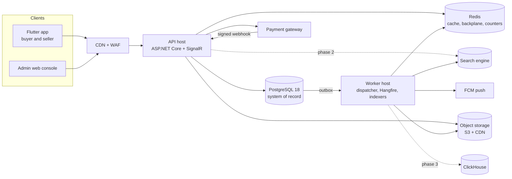
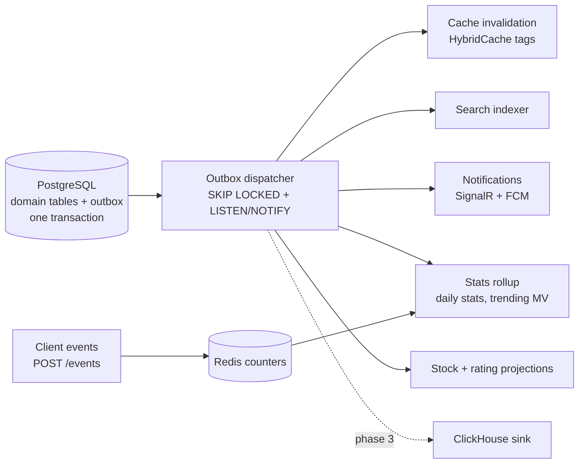
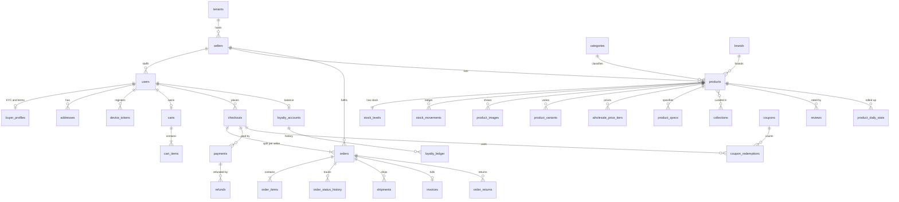
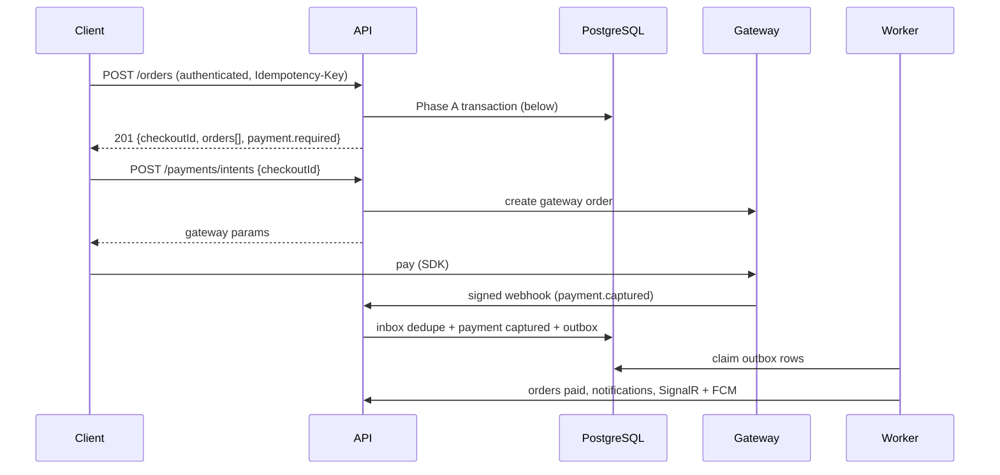

# Jewellery B2B — Backend Design v2 (.NET + PostgreSQL + supporting stores)

> **Status:** v2 of the backend design, produced after an architecture and database review of v1.
> The API contract is still derived from the Flutter client in `ecommerce_app/`
> (`product.dart`, `models/order.dart`, `models/coupon.dart`, `models/cms.dart`,
> `models/user.dart`, `pricing.dart`, `business_config.dart`, `commerce_store.dart`),
> so the app needs a transport swap, not a rewrite. Where v2 changes a v1 decision,
> the section says **CHANGED**; brand-new material says **NEW**.

---

## 0. Review summary

### 0.1 What v1 got right (kept)

- UUIDv7 keys, `timestamptz`, partial indexes, native enums for stable sets.
- Order lines snapshot name/brand/price (history immutability).
- Transactional outbox, RFC 7807 errors, keyset pagination, projection-only list queries.
- JSONB only where the shape is fluid (store rules, outbox payload); specs and tiers as child rows.
- ETag on store-config, `Idempotency-Key` on order placement, Testcontainers integration tests.

### 0.2 Findings

Severity: **P0** = produces wrong data, deadlocks or a security hole; **P1** = a real B2B launch needs it and v1 has no answer; **P2** = scale and hygiene.

| # | Sev | Area | What v1 had | v2 fix | § |
|---|---|---|---|---|---|
| 1 | P0 | Inventory | Stock and `in_stock` live on `products`. Every checkout rewrites the product row, so an owner editing a description gets a 409 because a customer bought something, and every sale busts the product cache. `updated_at` is not a real concurrency token. | Separate `stock_levels` table and append-only ledger; atomic conditional `UPDATE`; reservations; `xmin` as the row-version token on products. | 5.2, 6.3 |
| 2 | P0 | Orders | One `orders.owner_id` per order, but a cart can hold products from several sellers. | `checkouts` parent, one `orders` row per seller. | 5.3, 6.3 |
| 3 | P0 | Payments | No payment model (`payment_method text`), yet the design promises "never double-charge". | Payments module: intents, signed webhooks with inbox dedupe, refunds, reservation expiry. | 5.4, 6.3 |
| 4 | P0 | Idempotency | Key is globally unique on `orders`, duplicated in a second table, no payload hash, no in-flight state. | One `(user_id, key)` table with request hash and `in_progress/completed` state. | 5.7, 6.3 |
| 5 | P0 | Concurrency | Unordered `SELECT … FOR UPDATE` per line (deadlock risk); coupon `used_count` read-modify-write serialises every checkout. | Atomic conditional updates in sorted order; per-user advisory lock; `lock_timeout`. | 6.3 |
| 6 | P0 | Security | `/auth/demo` mints real JWTs and demo users are seeded. | Dev-only, compiled out of production, startup check refuses to boot with demo enabled. | 8, 16 |
| 7 | P0 | Identity | A custom `users` table and "ASP.NET Core Identity" cannot both be true; refresh "family" is described but not modelled; `shop_name` in the JWT goes stale. | Identity tables mapped into an `identity` schema, `family_id`, minimal claims. | 5.1, 8 |
| 8 | P0 | Tenancy | `coupons.code` is a global primary key; uniques are not tenant-scoped; "repository appends tenant filter" but no repository exists. | Composite keys, EF global query filter, RLS policies ready to switch on. | 2.4, 5 |
| 9 | P0 | Tax | Flat 18% GST, no HSN, no CGST/SGST/IGST split, no invoices. | HSN-driven `tax_rules`, place of supply, `invoices` with gap-free numbering. | 5.3, 6.1 |
| 10 | P1 | Pricing | Prices are static columns; `gold_rates` keeps one row per day per karat while real jewellery prices move with the metal rate during the day. | `pricing_mode` (`fixed` / `weight_based`), weights in mg, append-only intraday rates, re-quote at checkout. | 5.2, 6.1 |
| 11 | P1 | Money | Whole rupees break down with weight-based prices and per-line GST. | Minor units (paise) internally, rupee-rounded at the API edge with an explicit round-off line. | 1, 6.1 |
| 12 | P1 | Realtime | SignalR without a backplane does not scale horizontally; no push when the app is backgrounded. | Redis backplane, FCM push, notification fan-out from the outbox. | 9 |
| 13 | P1 | B2B model | No buyer verification (GSTIN/KYC), no price-visibility gating, no bulk import, no credit terms. | `buyer_profiles` with approval, server-gated prices, bulk import; price lists and credit as extension points. | 5.1, 7, 6.5 |
| 14 | P1 | Fulfilment | `returned` status exists but no shipments, returns or invoices. | `shipments`, `order_returns`, `invoices`. | 5.3 |
| 15 | P1 | Seller model | `owner_id` points at one user; shops have staff. `is_verified_supplier` is stored per product. | `sellers` table; verification is a seller attribute. | 5.1 |
| 16 | P1 | API gaps | No address/profile endpoints, media endpoints with no backing table, review write missing, view tracking implied by `GET`. | Added endpoints, `media_assets`, `POST /events`. | 5.7, 7 |
| 17 | P2 | Analytics | `product_views` inserts a row per view; trending aggregates `order_items` on demand. | Redis counters → daily rollup → materialised view. | 3, 5.2 |
| 18 | P2 | Indexes | "Indexes cover every sort" is not true (price, rating, bestsellers, keyset). Slug not unique; `unique(sku)` conflicts with soft delete; FK columns unindexed; no trigram index; FTS unweighted. | Rewritten index set. | 5.2, 12 |
| 19 | P2 | Architecture | "Modular monolith" was only folders: one `IAppDbContext`, nothing enforcing boundaries. | Modules with `.Contracts`, schema and DbContext per module, architecture tests, separate Worker host. | 2 |
| 20 | P2 | Outbox / cache | No retry, backoff, aggregate id or inbox; Hangfire polling load; "tag invalidation" assumed Redis-native. | `SKIP LOCKED` dispatcher with `LISTEN/NOTIFY`, inbox, HybridCache tags. | 5.7, 9, 12 |
| 21 | P2 | Operations | Logs only; compose only; no pooler, backups or DR story. | OpenTelemetry, PgBouncer, PITR, topology and SLOs. | 14, 15 |
| 22 | P2 | Search | Postgres FTS is right for the MVP but weak for jewellery vocabulary and facet counts. | Phase 2 search engine with synonyms; PG FTS stays as fallback. | 3, 11 |
| 23 | P2 | Licences | Several libraries have moved to commercial terms (see 1.1). | Alternatives listed. | 1.1 |

### 0.3 Decisions I assumed — please confirm

1. **One order per seller.** A multi-seller cart splits into one order per seller under a single checkout and a single payment. (`POST /orders` returns `orders[]`; for single-seller carts that is one element.)
2. **Paise internally.** Amounts are stored as minor units; the API still emits whole rupees to the current client. If you keep fixed prices and a flat tax forever, v1's whole-rupee rule would also work.
3. **Tax is data, not a constant.** The 18% in the client is a generic e-commerce default. Gold and silver jewellery is commonly taxed at 3% (and job-work labour at a different rate). Confirm HSN codes, rates, invoice timing and e-invoicing applicability with your CA before launch.
4. **Payment provider and credit terms.** Razorpay/Cashfree-style gateway for prepaid orders; approved buyers may get credit terms (no payment at checkout).
5. **Price visibility.** Wholesale/tier prices and MOQ are gated **only when the tenant flips
   `showPrices` to `approved_only`** (then they appear for approved buyers, enforced
   server-side, not just hidden in the app). The default rule (`all`, matching today's
   boolean `true`) keeps every price visible to everyone — current UI unchanged.
6. **Cancellation rights.** Customer until `confirmed`, seller until `packed`, admin until `shipped`; after `shipped` only returns apply.
7. **Guest checkout — dropped (CONFIRMED).** Browsing, search and the catalogue stay anonymous, but placing an order requires an authenticated buyer (the checkout's existing sign-in step, minus the guest path). No guest order rows; `checkouts.customer_id` stays `not null`.
8. **COD is supported (CONFIRMED).** `payment_method = 'COD'`: no gateway intent is created, `payment_status` stays `pending` until settled on delivery, the seller may confirm while pending, and the checkout never gets a payment-expiry deadline.

---

## 1. Stack — CHANGED

| Concern | v2 choice | Notes |
|---|---|---|
| Runtime | **.NET 10 (LTS)** | Supported to Nov 2028. |
| Web | ASP.NET Core **Controllers** (thin) + `Asp.Versioning` | Controllers live inside their module assembly (§2). |
| API docs | Built-in `Microsoft.AspNetCore.OpenApi` + Scalar or Swagger UI | Replaces Swashbuckle; OpenAPI document is the CI contract artifact. |
| ORM | **EF Core 10** + Npgsql; **Dapper** for the 3–5 hottest read queries | Listing, dashboard, trending. |
| Mapping | Mapperly (source-generated) | No runtime reflection mapper. |
| Application style | Explicit command/query handler classes + decorators (validation, transaction, idempotency, logging) | No mediator library needed. |
| Primary DB | **PostgreSQL 18** (17 supported) | PG 18 (Sept 2025) adds native `uuidv7()`, B-tree skip scan, async I/O; community support to Nov 2030. |
| Cache / hot state | **Redis 8** (or Valkey) through .NET **HybridCache** (L1 memory + L2 Redis) | Stampede protection and tag invalidation built in. Redis is never a source of truth. |
| Realtime | **SignalR** + Redis backplane | WebSockets-only transport (`SkipNegotiation`) so no sticky sessions. |
| Push | **FCM** (Android, and iOS via APNs) | SignalR only reaches foreground apps. |
| Identity | ASP.NET Core **Identity** (EF stores in `identity` schema) + JWT **ES256/RS256** with key rotation; OTP login | Access 15 min, rotating refresh 30 d with family reuse detection. |
| Object storage | **S3** + CDN (prod); S3-compatible emulator in dev (§17) | Private bucket for KYC and invoices. |
| Image processing | libvips via **NetVips** (preferred) or ImageSharp | Lower memory per resize; check ImageSharp licence terms. |
| Jobs | **Worker host** (outbox dispatcher as `BackgroundService`) + **Hangfire** (Postgres storage, own schema) for scheduled and one-off jobs | Separate process from the API. |
| Payments | `IPaymentGateway` port; Razorpay or Cashfree adapter | Webhook-driven (§6.3). |
| Search | Postgres FTS + `pg_trgm` now → **Meilisearch** or **Typesense** in phase 2 | Behind `ISearchService`. |
| Validation | FluentValidation | Request DTOs. |
| Errors | RFC 7807 `ProblemDetails` | Uniform. |
| Observability | Serilog + **OpenTelemetry** (traces, metrics, logs via OTLP) | Grafana stack, or Seq + Prometheus. |
| PDF | HTML→PDF (headless Chromium) or QuestPDF | Invoices; check QuestPDF licence tier. |
| Tests | xUnit + Testcontainers + Respawn + **Shouldly** + NetArchTest + FsCheck | See §19. |
| CI/CD | GitHub Actions (build, test, migrate, deploy) | Migrations run as a separate pipeline step. |

**Money rule — CHANGED:** `BIGINT` **minor units** (paise), column suffix `_minor`, with a `Money` value object in the domain. Percentages are basis points. Rounding is half-up at line level; order totals are rounded to the nearest rupee with an explicit `round_off_minor`. The DTO layer converts to whole rupees so the Flutter contract is unchanged (§6.1).

### 1.1 Licence watch

Check current terms before committing; these have moved toward commercial licensing for larger organisations: MediatR and AutoMapper (hence explicit handlers and Mapperly), FluentAssertions 8+ (hence Shouldly), ImageSharp (Six Labors split licence), QuestPDF (community tier limits), and the community edition of MinIO (hence a dev-only S3 emulator that is easy to swap). Redis 8 is available under AGPL; Valkey is the BSD-licensed fork if that matters to you.

---

## 2. Architecture — CHANGED

### 2.1 System context



Two deployables from one codebase: **Api** (request path, SignalR) and **Worker** (outbox dispatch, scheduled jobs, image processing, indexers). A slow image resize or a reindex can no longer steal threads or DB connections from checkout.

### 2.2 Solution layout

```
backend/
├── src/
│   ├── Api/                          # composition root: DI, middleware, SignalR hubs, OpenAPI
│   ├── Worker/                       # BackgroundServices + Hangfire server
│   ├── BuildingBlocks/               # Money, Result<T>, Outbox, Idempotency, Tenancy,
│   │                                 # ProblemDetails mapping, IUnitOfWork, auth abstractions
│   └── Modules/
│       ├── Catalog.Contracts/        # PUBLIC: interfaces, DTOs, integration events
│       ├── Catalog/                  # internal by default
│       │   ├── Domain/               # aggregates, value objects, domain events (no EF, no HTTP)
│       │   ├── Application/          # command/query handlers, validators
│       │   ├── Infrastructure/       # CatalogDbContext (schema "catalog"), migrations, adapters
│       │   ├── Endpoints/            # thin controllers
│       │   └── CatalogModule.cs      # AddCatalogModule(), MapCatalog()
│       ├── Ordering.Contracts/  ├── Ordering/
│       ├── Payments.Contracts/  ├── Payments/
│       ├── Promotions.Contracts/├── Promotions/
│       ├── Identity.Contracts/  ├── Identity/
│       ├── Engagement/          ├── Content/
├── tests/
│   ├── Architecture.Tests/           # NetArchTest: boundary rules (§2.3)
│   ├── Unit.Tests/                   # PricingEngine, state machines, Money
│   ├── Integration.Tests/            # WebApplicationFactory + Testcontainers
│   └── Contract.Tests/               # openapi.json diff
└── deploy/
    ├── docker-compose.yml  ├── Dockerfile.api  ├── Dockerfile.worker  └── .env.example
```

### 2.3 Module rules (enforced by `Architecture.Tests`, not by convention)

1. A module may reference **only another module's `.Contracts`** project. Everything else is `internal`.
2. Each module owns **one DbContext, one PostgreSQL schema and its own migrations history table**. No module queries another module's tables.
3. Cross-module reads go through a Contracts interface with **batch-shaped methods** (e.g. `ICatalogPricing.QuoteAsync(lines)`), never per-row calls in a loop.
4. Cross-module writes and reactions go through **integration events** published via the outbox (§5.7).
5. `Domain/` references nothing but BuildingBlocks (no EF Core, no ASP.NET types).
6. Controllers do four things only: bind, authorise, call one handler, map `Result<T>` to HTTP.
7. Reads project straight to DTOs (`AsNoTracking().Select`, or Dapper). Entities never leave a handler.
8. DB-level foreign keys across schemas are allowed (integrity safety net) but they are not a licence for code-level coupling; if a module is extracted later, its FKs are dropped and replaced by events.

**The one sanctioned shared transaction:** checkout (§6.3) needs Catalog stock, Promotions coupons and Ordering rows to commit atomically. `IUnitOfWork` opens one connection and transaction per request and enlists each module's DbContext (`Database.UseTransactionAsync`). Nothing else shares a transaction across modules.

### 2.4 Module map

| Module | Schema | Owns | Publishes | Consumes |
|---|---|---|---|---|
| Identity | `identity` | users, roles, sellers, buyer profiles, addresses, refresh tokens, device tokens | `BuyerApproved`, `UserRegistered` | — |
| Catalog | `catalog` | products, stock, pricing, gold rates, taxonomy, collections, daily stats | `ProductChanged`, `StockChanged`, `GoldRateChanged` | `OrderPlaced/Cancelled/Shipped` (stock), `ReviewPublished` (rating) |
| Ordering | `ordering` | carts, checkouts, orders, invoices, shipments, returns, tax rules | `CheckoutPlaced`, `OrderPlaced`, `OrderStatusChanged`, `OrderCancelled` | `PaymentCaptured`, `PaymentFailed`, `RefundProcessed` |
| Payments | `payments` | payments, refunds, webhook inbox | `PaymentCaptured`, `PaymentFailed`, `RefundProcessed` | `OrderCancelled` (refund trigger) |
| Promotions | `promotions` | coupons, redemptions, loyalty | `LoyaltyAwarded` | `OrderDelivered`, `OrderReturned`, `OrderCancelled` |
| Engagement | `engagement` | wishlist, reviews, notifications | `ReviewPublished` | all order, payment and stock events (to build notifications) |
| Content | `content` | store settings, hero slides, nav and home layout | `StoreConfigChanged` | — |
| Platform (building blocks) | `platform` | tenants, outbox, inbox, idempotency, audit, media assets, number sequences | — | — |

Payments and Ordering never reference each other: they talk only through events, so there is no dependency cycle.

### 2.5 Request paths

- **Read:** controller → query handler → `AsNoTracking` projection or Dapper → DTO. Cache via HybridCache where §12 says so.
- **Write:** controller → validator → (idempotency decorator) → transaction decorator → handler → aggregate → `SaveChanges` → an EF interceptor turns domain events into `outbox_messages` rows **in the same transaction**.
- **Async:** Worker claims outbox rows (`FOR UPDATE SKIP LOCKED`), publishes in-process to module consumers, each consumer records itself in the inbox so redelivery is harmless.

### 2.6 Tenancy — CHANGED

`ITenantContext` is resolved from the JWT. Every module DbContext applies an EF **global query filter** on `tenant_id`. Row-level security policies are defined in the schema (§5.8) and switched on when a second tenant onboards, with `SET LOCAL app.tenant_id` issued per transaction by a connection interceptor (works with PgBouncer transaction pooling because it is transaction-scoped).

### 2.7 Why not microservices yet

At the sizes in Appendix A (10⁵ SKUs, ~10³ orders/day) a single Postgres and two deployables are comfortably enough. Split order if ever needed: **Catalog read path first** (read-heavy, cacheable), then Notifications/Search indexing, then Payments. Ordering and Inventory stay together as long as checkout needs one ACID transaction.

---

## 3. Data architecture and database choices — NEW

### 3.1 Principle

**PostgreSQL is the only system of record for transactional data.** Every other store is either derived and rebuildable from Postgres (cache, search index, analytics, image variants) or holds blobs (object storage). Losing Redis or the search index costs latency, never data.

### 3.2 Store-by-store decision

| Store | Holds | Source of truth? | Why | Add when |
|---|---|---|---|---|
| **PostgreSQL 18** | users, catalog, stock, orders, payments, coupons, CMS (JSONB), outbox, job queue (own schema), MVP search (FTS + trigram) | **Yes** | Multi-row ACID for money and stock, row locks and conditional updates, partial and GIN indexes, JSONB, `SKIP LOCKED` queues, RLS | Day 1 |
| **Redis 8 / Valkey** | HybridCache L2, rate-limit counters, SignalR backplane, view counters, recently-viewed lists, OTP codes, idempotency fast-path | No (rebuildable) | Microsecond reads and atomic counters | Day 1 |
| **S3 + CDN** | image originals and variants, invoice PDFs, KYC documents (private bucket, SSE-KMS) | Yes, for originals | Cheap durable blobs; CDN removes media load from the API | Day 1 |
| **Meilisearch or Typesense** (OpenSearch if you are on managed AWS and want it) | search index: products, synonyms, facet counts | No (rebuilt from PG via outbox) | Typo tolerance, **synonyms for jewellery vocabulary** (jhumka/jhumki, mangalsutra/mangal sutra, kada/bangle), cheap facet counts for the filter UI | Phase 2: facets needed on the listing screen, or search quality complaints, or > ~50k SKUs with rich filtering |
| **ClickHouse** | event stream: product views, impressions, searches, seller analytics | No (derived) | Columnar scans over hundreds of millions of events | Phase 3: > ~50–100M events/month or seller dashboards slow on PG rollups |
| **Message broker** (RabbitMQ, SQS or Azure Service Bus) | integration events between services | No | Fan-out and decoupling once modules become services | Phase 3 / on first service extraction. Until then the PG outbox is the broker |
| **pgvector** (Postgres extension, not a separate DB) | image or text embeddings for "similar designs" / search-by-photo | No (derived) | HNSW inside the same Postgres at 10⁵ items | Phase 3, optional feature |

### 3.3 Considered and not recommended

| Option | Why not |
|---|---|
| MongoDB / DynamoDB / Cassandra as primary | Orders, stock, coupons and payments need multi-row ACID; JSONB already covers the few flexible shapes. |
| Elasticsearch/OpenSearch as primary | Not transactional; fine as a derived index only. |
| Redis-only carts | Loses durability and cross-device carts, which B2B buyers rely on. Carts stay in PG; Redis only caches. |
| TimescaleDB for analytics | Managed availability and licensing vary; native partitioning plus rollups is enough until ClickHouse is justified. |
| Distributed SQL (CockroachDB, Aurora DSQL) | Solves multi-region write scale you do not have; costs latency and complexity. |
| Graph DB for recommendations | "Related products" is category/metal/occasion similarity; one indexed query, later pgvector. |
| Firebase/Firestore | Lock-in and weak relational integrity for money. |

### 3.4 Data flow



### 3.5 PostgreSQL operating rules — NEW

- **Extensions:** `citext`, `pg_trgm`, `pg_stat_statements` (phase 3: `vector`).
- **Roles:** `migrator` (DDL only, used by the pipeline), `app_rw` (API, not the table owner so RLS applies), `worker_rw`, `readonly` (analysts, replicas). No superuser in the app.
- **Timeouts:** `statement_timeout = 5s` for API roles, higher for `worker_rw`; `lock_timeout = 2s` set locally in checkout; `idle_in_transaction_session_timeout = 15s`.
- **Pooling:** PgBouncer in transaction mode in front of Postgres. Per-instance Npgsql `Maximum Pool Size` 20–30 (not 100) so N API instances plus the Worker stay under `max_connections`.
- **Hot-row tables:** `catalog.stock_levels` uses `fillfactor = 70` and has no secondary indexes on the columns that change, so updates stay HOT and bloat stays low; tighter autovacuum thresholds on it.
- **Append-only tables** (`stock_movements`, `product_daily_stats`, `audit_log`, `notifications`) are partitioned by month once they pass ~50M rows, or sooner where the table below says so.
- **Backups:** continuous WAL archiving with point-in-time recovery, daily base backup, monthly restore drill. Targets (adjust to your business): RPO ≤ 5 min, RTO ≤ 1 h.
- **Version policy:** PG 18 for new installs (native `uuidv7()`); PG 17 works if your managed provider lags — generate UUIDv7 in the app with `Guid.CreateVersion7()`.
- **Virtual generated columns:** PG 18 makes `VIRTUAL` the default for generated columns; the `tsvector` column in §5.2 is explicitly `STORED` because it must be indexed.

---

## 4. Domain model (ER) — CHANGED



---

## 5. Schema (PostgreSQL) — CHANGED

### 5.0 Conventions

- One PostgreSQL **schema per module** (`identity`, `catalog`, `ordering`, `payments`, `promotions`, `engagement`, `content`, `platform`).
- `id uuid primary key default uuidv7()` (PG 18; on PG 17 the app supplies `Guid.CreateVersion7()`).
- `timestamptz` everywhere; money in `bigint` **minor units** with `_minor` suffix; percentages in basis points (`_bps`).
- Soft delete via `deleted_at timestamptz` on catalogue rows, with **partial** unique indexes so a deleted SKU/slug can be reused.
- Native enums only for stable sets (`order_status`); anything a tenant can edit is a lookup table or `text` + `CHECK`.
- **Every foreign key column gets an index** (Postgres does not create them) unless it is the leading column of an existing index.
- Optimistic concurrency on `products`, `orders`, `coupons` uses the **`xmin` system column** (EF maps a `uint` property as the row-version token), not `updated_at`.

```sql
create extension if not exists citext;
create extension if not exists pg_trgm;
create extension if not exists pg_stat_statements;

create schema identity;   create schema catalog;   create schema ordering;
create schema payments;   create schema promotions; create schema engagement;
create schema content;    create schema platform;
```

### 5.1 Identity

```sql
create table platform.tenants (
  id uuid primary key default uuidv7(),
  name text not null,
  business_type text not null,                 -- 'jewellery' | 'fashion' | ...
  status text not null default 'active' check (status in ('active','suspended')),
  created_at timestamptz not null default now()
);

-- A shop. The platform's own stock is the single row with is_platform = true
-- (replaces v1's nullable owner_id).
create table identity.sellers (
  id uuid primary key default uuidv7(),
  tenant_id uuid not null references platform.tenants,
  name text not null,
  gstin text,
  state_code char(2) not null,                 -- GST state code → CGST+SGST vs IGST
  is_platform boolean not null default false,
  is_verified boolean not null default false,  -- was products.is_verified_supplier
  status text not null default 'pending' check (status in ('pending','active','suspended')),
  created_at timestamptz not null default now()
);
create unique index ux_sellers_platform on identity.sellers (tenant_id) where is_platform;

-- ASP.NET Core Identity tables (users, roles, user_roles, user_claims, user_logins,
-- user_tokens) are mapped into the identity schema. Standard columns
-- (normalized_email, security_stamp, lockout_end, access_failed_count, ...) come from
-- the Identity migration; only custom columns and constraints are shown.
-- Roles (rows in identity.roles): customer, seller_owner, seller_staff, admin, support.
create table identity.users (
  id uuid primary key default uuidv7(),
  tenant_id uuid not null references platform.tenants,
  seller_id uuid references identity.sellers,  -- set for seller_owner / seller_staff
  name text not null,
  email citext not null,
  phone text not null,                         -- E.164
  phone_verified_at timestamptz,
  password_hash text,                          -- null for OTP-only accounts
  is_active boolean not null default true,
  created_at timestamptz not null default now(),
  updated_at timestamptz not null default now(),
  unique (tenant_id, email),
  unique (tenant_id, phone)
);
create index on identity.users (seller_id) where seller_id is not null;

-- B2B account: who is buying and are they approved?
create table identity.buyer_profiles (
  user_id uuid primary key references identity.users on delete cascade,
  business_name text not null,
  gstin text,
  pan text,
  kyc_status text not null default 'pending'
        check (kyc_status in ('pending','approved','rejected','suspended')),
  kyc_reviewed_by uuid references identity.users,
  kyc_reviewed_at timestamptz,
  kyc_media_ids uuid[] not null default '{}',  -- private media assets
  credit_limit_minor bigint not null default 0,-- 0 ⇒ prepaid only
  payment_terms_days int not null default 0
);

create table identity.refresh_tokens (
  id uuid primary key default uuidv7(),
  user_id uuid not null references identity.users on delete cascade,
  family_id uuid not null,                     -- one login session; reuse of a revoked token revokes the family
  token_hash text not null unique,             -- only the hash is stored
  expires_at timestamptz not null,
  revoked_at timestamptz,
  replaced_by uuid,
  device_id text, user_agent text, created_ip inet,
  created_at timestamptz not null default now()
);
create index ix_refresh_family on identity.refresh_tokens (family_id);
create index ix_refresh_active on identity.refresh_tokens (user_id) where revoked_at is null;

create table identity.addresses (
  id uuid primary key default uuidv7(),
  user_id uuid not null references identity.users on delete cascade,
  label text,
  contact_name text not null, phone text not null,
  line1 text not null, line2 text,
  city text not null, state text not null,
  state_code char(2) not null,                 -- place of supply
  pincode char(6) not null,
  gstin text,
  is_default boolean not null default false
);
create index on identity.addresses (user_id);
create unique index ux_addresses_default on identity.addresses (user_id) where is_default;

create table identity.device_tokens (            -- FCM registration tokens
  id uuid primary key default uuidv7(),
  user_id uuid not null references identity.users on delete cascade,
  platform text not null check (platform in ('android','ios','web')),
  token text not null unique,
  created_at timestamptz not null default now(),
  last_seen_at timestamptz not null default now(),
  revoked_at timestamptz
);
create index on identity.device_tokens (user_id) where revoked_at is null;
```

OTP codes and login-attempt counters live in Redis (short TTL), not Postgres.

### 5.2 Catalog

```sql
create table catalog.categories (
  id uuid primary key default uuidv7(),
  tenant_id uuid not null references platform.tenants,
  name text not null,
  slug text not null,
  icon_emoji text,
  display_order int not null default 0,
  is_visible boolean not null default true,
  unique (tenant_id, slug)
);

create table catalog.brands (
  id uuid primary key default uuidv7(),
  tenant_id uuid not null references platform.tenants,
  name text not null,
  slug text not null,
  unique (tenant_id, slug)
);

-- Source of truth for Taxonomy.metals / purities / families / styles / audiences / occasions.
-- Product columns stay plain text for cheap filtering; the Catalog handler validates
-- against this table and a nightly integrity job reports drift.
create table catalog.taxonomy_terms (
  tenant_id uuid not null references platform.tenants,
  kind text not null check (kind in ('metal','purity','family','style','audience','occasion')),
  value text not null,
  label text not null,
  position int not null default 0,
  is_active boolean not null default true,
  primary key (tenant_id, kind, value)
);

create table catalog.products (
  id uuid primary key default uuidv7(),
  tenant_id uuid not null references platform.tenants,
  seller_id uuid not null references identity.sellers,
  brand_id uuid not null references catalog.brands,
  category_id uuid not null references catalog.categories,
  name text not null,
  slug text not null,
  sku text not null,
  seo_title text not null default '',
  description text not null default '',
  status text not null default 'draft' check (status in ('draft','active','archived')),
  hsn_code text not null default '7113',       -- drives tax (ordering.tax_rules)

  -- pricing (§6.1)
  pricing_mode text not null default 'fixed' check (pricing_mode in ('fixed','weight_based')),
  price_minor bigint not null check (price_minor >= 0),  -- fixed: authoritative unit price
                                                         -- weight_based: cached list price, refreshed by Worker
  mrp_minor bigint not null check (mrp_minor >= 0),
  price_usd_minor bigint not null default 0,   -- display override, 0 = derive from FX
  net_weight_mg integer check (net_weight_mg > 0),       -- milligrams: exact integer maths
  gross_weight_mg integer check (gross_weight_mg > 0),
  stone_value_minor bigint not null default 0,
  making_charge_kind text check (making_charge_kind in ('percent','per_gram','flat')),
  making_charge_value bigint,                  -- percent: basis points; per_gram/flat: minor units
  check (pricing_mode = 'fixed'
         or (net_weight_mg is not null
             and making_charge_kind is not null
             and making_charge_value is not null)),

  minimum_order_quantity integer not null default 1 check (minimum_order_quantity >= 1),
  delivery_days integer not null default 3,
  family text not null default '',
  style text not null default '',
  metal text not null default '',
  purity text not null default '',
  audience text not null default '',
  occasions text[] not null default '{}',
  highlights text[] not null default '{}',      -- display bullets on cards/PDP (client `highlights`)
  discount_bps integer not null generated always as (   -- powers the `discount` sort + % OFF badge
    case when mrp_minor > price_minor
         then ((mrp_minor - price_minor) * 10000 / mrp_minor) else 0 end) stored,

  rating_sum integer not null default 0,       -- avg = rating_sum / review_count (no rounding drift)
  review_count integer not null default 0,

  search_text text not null default '',        -- app-maintained: brand, category, metal, occasions, synonyms
  search_vector tsvector generated always as (
      setweight(to_tsvector('simple', name), 'A') ||
      setweight(to_tsvector('simple', sku), 'A') ||
      setweight(to_tsvector('simple', search_text), 'B') ||
      setweight(to_tsvector('simple', description), 'D')
  ) stored,

  deleted_at timestamptz,
  created_at timestamptz not null default now(),
  updated_at timestamptz not null default now()
  -- no stock column: see catalog.stock_levels. Concurrency token = xmin.
);

-- uniqueness only among live rows (soft delete must not block re-use)
create unique index ux_products_slug on catalog.products (tenant_id, slug) where deleted_at is null;
create unique index ux_products_sku  on catalog.products (tenant_id, sku)  where deleted_at is null;

-- keyset-friendly listing indexes: filter column(s), then sort key, then id
create index ix_products_new    on catalog.products (tenant_id, category_id, created_at desc, id desc)
  where deleted_at is null and status = 'active';
create index ix_products_price  on catalog.products (tenant_id, category_id, price_minor, id)
  where deleted_at is null and status = 'active';
create index ix_products_metal  on catalog.products (tenant_id, metal, created_at desc, id desc)
  where deleted_at is null and status = 'active';
create index ix_products_seller on catalog.products (seller_id, created_at desc, id desc)
  where deleted_at is null;
create index ix_products_brand on catalog.products (brand_id) where deleted_at is null;
create index ix_products_discount on catalog.products (tenant_id, discount_bps desc, id desc)
  where deleted_at is null and status = 'active';

-- search (MVP)
create index ix_products_fts       on catalog.products using gin (search_vector);
create index ix_products_name_trgm on catalog.products using gin (name gin_trgm_ops) where deleted_at is null;
create index ix_products_sku_trgm  on catalog.products using gin (sku  gin_trgm_ops) where deleted_at is null;
create index ix_products_occasions on catalog.products using gin (occasions);

-- Stock is split from the product row so sales never touch product content.
create table catalog.stock_levels (
  product_id uuid primary key references catalog.products on delete cascade,
  track_inventory boolean not null default true,  -- false ⇒ made-to-order / platform stock (v1 "ownerId empty")
  on_hand integer not null default 0 check (on_hand >= 0),
  reserved integer not null default 0 check (reserved >= 0),
  low_stock_threshold integer not null default 5,
  updated_at timestamptz not null default now(),
  check (reserved <= on_hand)
) with (fillfactor = 70);
-- available = on_hand - reserved. isAvailable = status='active' and
-- (not track_inventory or available >= minimum_order_quantity)

create table catalog.stock_movements (          -- append-only ledger
  id uuid primary key default uuidv7(),
  product_id uuid not null references catalog.products,
  on_hand_delta integer not null default 0,
  reserved_delta integer not null default 0,
  reason text not null check (reason in
    ('reserve','release','commit','restock','adjust','return','import')),
  order_id uuid,
  actor_id uuid,
  created_at timestamptz not null default now()
);
create index ix_stock_movements_product on catalog.stock_movements (product_id, created_at desc);

create table catalog.product_images (
  id uuid primary key default uuidv7(),
  product_id uuid not null references catalog.products on delete cascade,
  media_id uuid not null references platform.media_assets,  -- URL is derived from the key + CDN base
  position int not null default 0,
  alt text not null default ''
);
create index on catalog.product_images (product_id, position);

create table catalog.product_variants (
  id uuid primary key default uuidv7(),
  product_id uuid not null references catalog.products on delete cascade,
  kind text not null check (kind in ('size','shade')),
  name text not null,
  swatch_hex text,
  position int not null default 0,
  unique (product_id, kind, name)
);

create table catalog.wholesale_price_tiers (
  id uuid primary key default uuidv7(),
  product_id uuid not null references catalog.products on delete cascade,
  minimum_quantity int not null check (minimum_quantity >= 2),
  unit_price_minor bigint not null check (unit_price_minor > 0),
  unique (product_id, minimum_quantity)
);
-- handler rule: tier prices strictly decrease as minimum_quantity increases

-- Display specs ('Gold Purity', 'Gross Weight'). Anything the server computes with
-- (weights, purity) is a typed column on products, never parsed from here.
create table catalog.product_specs (
  id uuid primary key default uuidv7(),
  product_id uuid not null references catalog.products on delete cascade,
  field_key text not null,
  field_value text not null,
  position int not null default 0,
  unique (product_id, field_key)
);

create table catalog.collections (
  id uuid primary key default uuidv7(),
  tenant_id uuid not null references platform.tenants,
  name text not null,
  slug text not null,
  route text not null default '',
  image_media_id uuid references platform.media_assets,
  visible boolean not null default true,
  position int not null default 0,
  unique (tenant_id, slug)
);
create table catalog.collection_products (
  collection_id uuid not null references catalog.collections on delete cascade,
  product_id uuid not null references catalog.products on delete cascade,
  position int not null default 0,
  primary key (collection_id, product_id)
);
create index on catalog.collection_products (product_id);

-- Replaces v1 product_views. Counters are accumulated in Redis and flushed here
-- by the Worker; units_sold is adjusted by cancellations and returns.
create table catalog.product_daily_stats (
  product_id uuid not null references catalog.products on delete cascade,
  day date not null,
  views integer not null default 0,
  wishlist_adds integer not null default 0,
  units_sold integer not null default 0,
  primary key (product_id, day)
) partition by range (day);                      -- monthly partitions created by the Worker
create index on catalog.product_daily_stats (day);

create materialized view catalog.mv_trending_30d as
  select p.tenant_id, s.product_id, sum(s.units_sold) as units_30d
  from catalog.product_daily_stats s
  join catalog.products p on p.id = s.product_id
  where s.day >= current_date - 30 and p.deleted_at is null and p.status = 'active'
  group by p.tenant_id, s.product_id;
create unique index on catalog.mv_trending_30d (tenant_id, product_id);
create index on catalog.mv_trending_30d (tenant_id, units_30d desc);
-- REFRESH MATERIALIZED VIEW CONCURRENTLY every ~10 min (Worker).
-- Tie-breaks (occasion count → reviews → rating) are applied when the rail is queried.

-- Append-only, so intraday movements are kept. Current rate = latest row per (metal, karat).
create table catalog.gold_rates (
  id uuid primary key default uuidv7(),
  tenant_id uuid not null references platform.tenants,
  metal text not null default 'gold' check (metal in ('gold','silver','platinum')),
  karat text not null,                           -- '24K','22K','18K' (or '925' for silver)
  rate_per_gram_minor bigint not null check (rate_per_gram_minor > 0),
  source text not null check (source in ('feed','manual')),
  effective_at timestamptz not null default now(),
  set_by uuid references identity.users
);
create index on catalog.gold_rates (tenant_id, metal, karat, effective_at desc);
```

### 5.3 Ordering (cart, checkout, orders, fulfilment, invoices)

```sql
-- Tax is data. Rate applies to the value of supply for that HSN code.
create table ordering.tax_rules (
  id uuid primary key default uuidv7(),
  tenant_id uuid not null references platform.tenants,
  hsn_code text not null,                        -- '*' = tenant fallback
  supply_kind text not null default 'goods' check (supply_kind in ('goods','job_work')),
  rate_bps integer not null check (rate_bps >= 0),    -- 300 = 3%
  effective_from date not null,
  effective_to date,
  unique (tenant_id, hsn_code, supply_kind, effective_from)
);

create table ordering.carts (
  id uuid primary key default uuidv7(),
  tenant_id uuid not null references platform.tenants,
  user_id uuid not null unique references identity.users on delete cascade,
  coupon_code citext,
  updated_at timestamptz not null default now()
);

create table ordering.cart_items (
  id uuid primary key default uuidv7(),
  cart_id uuid not null references ordering.carts on delete cascade,
  product_id uuid not null references catalog.products,
  quantity int not null check (quantity > 0),
  selected_size text,
  selected_shade text,
  added_unit_price_minor bigint,                 -- lets the cart say "price changed since you added this"
  created_at timestamptz not null default now(),
  -- one line per product+size+shade (client lineKey rule); NULLs compare equal (PG 15+)
  unique nulls not distinct (cart_id, product_id, selected_size, selected_shade)
);
create index on ordering.cart_items (product_id);

-- One customer checkout = one payment = N seller orders.
create table ordering.checkouts (
  id uuid primary key default uuidv7(),
  tenant_id uuid not null references platform.tenants,
  customer_id uuid not null references identity.users,
  currency char(3) not null default 'INR',
  shipping_address jsonb not null,               -- immutable snapshot (incl. state_code, pincode)
  billing_address jsonb not null,
  buyer_gstin text,
  coupon_code citext,
  coupon_discount_minor bigint not null default 0,
  grand_total_minor bigint not null,
  delivery_option text not null default 'standard'
        check (delivery_option in ('standard','express','priority')),  -- ETA choice; charge unchanged (§6.1)
  gift_wrap boolean not null default false,      -- from the cart line (UI gift-wrap option)
  gift_note text,
  payment_method text not null default 'UPI',    -- 'UPI','CARD','NETBANKING','RTGS','CREDIT','COD'
  payment_status text not null default 'pending'
        check (payment_status in ('pending','paid','failed','refunded','partially_refunded','on_credit')),
  expires_at timestamptz,                        -- prepaid only (never set for COD/on_credit): Worker cancels and releases stock
  placed_at timestamptz not null default now()
);
create index on ordering.checkouts (customer_id, placed_at desc);
create index ix_checkouts_expiring on ordering.checkouts (expires_at)
  where payment_status = 'pending' and payment_method <> 'COD';

create sequence ordering.order_number_seq;       -- 'ORD-2026-' || lpad(nextval, 6, '0'); gaps are fine here

create type ordering.order_status as enum
  ('placed','confirmed','packed','shipped','out_for_delivery','delivered','cancelled','returned');

create table ordering.orders (
  id uuid primary key default uuidv7(),
  order_number text not null unique,
  tenant_id uuid not null references platform.tenants,
  checkout_id uuid not null references ordering.checkouts,
  customer_id uuid not null references identity.users,
  seller_id uuid not null references identity.sellers,
  customer_name text not null,                   -- snapshots
  seller_name text not null,
  status ordering.order_status not null default 'placed',
  payment_status text not null default 'pending'
        check (payment_status in ('pending','paid','failed','refunded','partially_refunded','on_credit')),
  payment_method text not null default 'UPI',    -- mirrored from checkout (incl. 'COD')
  delivery_option text not null default 'standard',  -- mirrored from checkout (ETA display + fulfilment)
  currency char(3) not null default 'INR',
  subtotal_minor bigint not null,                -- sum of line nets, before coupon
  coupon_discount_minor bigint not null default 0,  -- this order's pro-rata share
  taxable_minor bigint not null,
  cgst_minor bigint not null default 0,
  sgst_minor bigint not null default 0,
  igst_minor bigint not null default 0,
  tax_minor bigint not null,
  shipping_minor bigint not null,
  round_off_minor bigint not null default 0,
  total_minor bigint not null,
  cancelled_reason text,
  placed_at timestamptz not null default now(),
  updated_at timestamptz not null default now(),
  check (taxable_minor = subtotal_minor - coupon_discount_minor),
  check (tax_minor = cgst_minor + sgst_minor + igst_minor),
  check (total_minor = taxable_minor + tax_minor + shipping_minor + round_off_minor)
);
create index ix_orders_customer on ordering.orders (customer_id, placed_at desc, id desc);
create index ix_orders_seller   on ordering.orders (seller_id, status, placed_at desc, id desc);
create index ix_orders_checkout  on ordering.orders (checkout_id);

create table ordering.order_items (
  id uuid primary key default uuidv7(),
  order_id uuid not null references ordering.orders on delete cascade,
  product_id uuid not null references catalog.products,
  sku text not null, name text not null, brand text not null,   -- immutable snapshots
  hsn_code text not null,
  image_key text,                                -- primary image storage key only
  selected_size text, selected_shade text,
  quantity integer not null check (quantity > 0),
  unit_price_minor bigint not null,
  line_net_minor bigint not null,                -- unit_price × quantity
  discount_minor bigint not null default 0,      -- allocated share of the coupon
  tax_rate_bps integer not null,
  tax_minor bigint not null,
  pricing_snapshot jsonb,                        -- weight_based: {rate, karat, netWeightMg, making, stones, rateAt}
  check (line_net_minor = unit_price_minor * quantity)
);
create index on ordering.order_items (order_id);
create index on ordering.order_items (product_id);

create table ordering.order_status_history (
  id uuid primary key default uuidv7(),
  order_id uuid not null references ordering.orders on delete cascade,
  from_status ordering.order_status,
  to_status ordering.order_status not null,
  changed_by uuid references identity.users,
  actor_role text,                               -- customer | seller | admin | system
  changed_at timestamptz not null default now(),
  note text
);
create index on ordering.order_status_history (order_id, changed_at);

create table ordering.shipments (
  id uuid primary key default uuidv7(),
  order_id uuid not null references ordering.orders on delete cascade,
  carrier text not null,
  awb text,
  tracking_url text,
  insured_value_minor bigint not null default 0, -- high-value jewellery ships insured
  shipped_at timestamptz,
  delivered_at timestamptz,
  created_at timestamptz not null default now()
);
create index on ordering.shipments (order_id);

create table ordering.invoices (
  id uuid primary key default uuidv7(),
  tenant_id uuid not null references platform.tenants,
  order_id uuid not null unique references ordering.orders,
  seller_id uuid not null references identity.sellers,
  financial_year text not null,                  -- '2026-27'
  invoice_no text not null,                      -- gap-free per (seller, FY): platform.number_sequences
  issued_at timestamptz not null default now(),
  seller_gstin text, buyer_gstin text,
  place_of_supply char(2) not null,
  taxable_minor bigint not null,
  cgst_minor bigint not null default 0,
  sgst_minor bigint not null default 0,
  igst_minor bigint not null default 0,
  round_off_minor bigint not null default 0,
  total_minor bigint not null,
  pdf_media_id uuid references platform.media_assets,
  irn text,                                      -- e-invoice reference where applicable
  unique (seller_id, financial_year, invoice_no)
);

create table ordering.order_returns (
  id uuid primary key default uuidv7(),
  order_id uuid not null references ordering.orders,
  order_item_id uuid not null references ordering.order_items,
  quantity integer not null check (quantity > 0),
  reason text not null,
  status text not null default 'requested'
        check (status in ('requested','approved','rejected','received','refunded')),
  refund_minor bigint not null default 0,
  requested_at timestamptz not null default now(),
  resolved_at timestamptz
);
create index on ordering.order_returns (order_id);
create index on ordering.order_returns (order_item_id);
```

### 5.4 Payments — NEW

```sql
create table payments.payments (
  id uuid primary key default uuidv7(),
  tenant_id uuid not null references platform.tenants,
  checkout_id uuid not null references ordering.checkouts,
  provider text not null,                        -- 'razorpay' | 'cashfree' | ...
  provider_order_id text,
  provider_payment_id text,
  method text,
  status text not null default 'created'
        check (status in ('created','authorized','captured','failed','cancelled')),
  amount_minor bigint not null check (amount_minor > 0),
  currency char(3) not null default 'INR',
  failure_code text,
  created_at timestamptz not null default now(),
  updated_at timestamptz not null default now(),
  unique (provider, provider_payment_id)
);
create index on payments.payments (checkout_id);
create unique index ux_payments_provider_order on payments.payments (provider, provider_order_id)
  where provider_order_id is not null;

create table payments.refunds (
  id uuid primary key default uuidv7(),
  payment_id uuid not null references payments.payments,
  order_id uuid not null references ordering.orders,
  amount_minor bigint not null check (amount_minor > 0),
  status text not null default 'pending' check (status in ('pending','processed','failed')),
  provider_refund_id text unique,
  reason text,
  created_at timestamptz not null default now(),
  processed_at timestamptz
);
create index on payments.refunds (payment_id);
create index on payments.refunds (order_id);

-- Webhook inbox: dedupe by provider event id, keep the raw payload for audit.
create table payments.webhook_events (
  provider text not null,
  event_id text not null,
  payload jsonb not null,
  received_at timestamptz not null default now(),
  processed_at timestamptz,
  primary key (provider, event_id)
);
```

### 5.5 Promotions and engagement

```sql
create table promotions.coupons (
  tenant_id uuid not null references platform.tenants,
  code citext not null,                          -- unique per tenant, case-insensitive
  seller_id uuid references identity.sellers,    -- null = platform-funded
  flat_off_minor bigint not null check (flat_off_minor > 0),
  min_subtotal_minor bigint not null default 0,
  description text not null default '',
  starts_at timestamptz,
  ends_at timestamptz,
  usage_limit int not null default 0,            -- 0 ⇒ unlimited
  per_user_limit int not null default 0,         -- 0 ⇒ unlimited
  used_count int not null default 0,
  is_active boolean not null default true,
  primary key (tenant_id, code)
);

create table promotions.coupon_redemptions (
  id uuid primary key default uuidv7(),
  tenant_id uuid not null,
  coupon_code citext not null,
  checkout_id uuid not null references ordering.checkouts,
  user_id uuid not null references identity.users,
  discount_minor bigint not null,
  status text not null default 'applied' check (status in ('applied','reversed')),
  created_at timestamptz not null default now(),
  reversed_at timestamptz,
  foreign key (tenant_id, coupon_code) references promotions.coupons,
  unique (tenant_id, coupon_code, checkout_id)
);
create index on promotions.coupon_redemptions (user_id, coupon_code);

create table promotions.loyalty_accounts (       -- balance moved off identity.users
  user_id uuid primary key references identity.users on delete cascade,
  points integer not null default 0 check (points >= 0),
  updated_at timestamptz not null default now()
);
create table promotions.loyalty_ledger (
  id uuid primary key default uuidv7(),
  user_id uuid not null references identity.users on delete cascade,
  delta int not null,
  balance_after int not null,
  reason text not null,
  order_id uuid references ordering.orders,
  created_at timestamptz not null default now()
);
create index on promotions.loyalty_ledger (user_id, created_at desc);
create unique index ux_loyalty_once on promotions.loyalty_ledger (order_id, reason) where order_id is not null;
-- points are awarded when an order is DELIVERED (not at checkout) and reversed on return

create table engagement.wishlists (
  user_id uuid not null references identity.users on delete cascade,
  product_id uuid not null references catalog.products on delete cascade,
  created_at timestamptz not null default now(),
  primary key (user_id, product_id)
);
create index on engagement.wishlists (product_id);

create table engagement.reviews (
  id uuid primary key default uuidv7(),
  product_id uuid not null references catalog.products on delete cascade,
  user_id uuid not null references identity.users,
  order_item_id uuid references ordering.order_items,   -- set ⇒ verified purchase
  rating smallint not null check (rating between 1 and 5),
  title text not null default '',
  body text not null default '',
  status text not null default 'pending' check (status in ('pending','published','rejected')),
  created_at timestamptz not null default now(),
  unique (product_id, user_id)
);
create index on engagement.reviews (product_id, status, created_at desc);

create table engagement.notifications (
  id uuid primary key default uuidv7(),
  user_id uuid not null references identity.users on delete cascade,
  type text not null,                            -- client NotificationType names
  title text not null,
  body text not null,
  route text,
  data jsonb,
  dedupe_key text,                               -- redelivery of the same event creates no second row
  is_read boolean not null default false,
  created_at timestamptz not null default now(),
  unique (user_id, dedupe_key)
);
create index ix_notif_feed   on engagement.notifications (user_id, created_at desc, id desc);
create index ix_notif_unread on engagement.notifications (user_id) where not is_read;
```

### 5.6 Content (owner-editable store config)

```sql
create table content.store_settings (
  id uuid primary key default uuidv7(),
  tenant_id uuid not null unique references platform.tenants,
  name text not null,
  tagline text not null default '',
  currency text not null default 'INR',
  currency_symbol text not null default '₹',
  primary_hex text not null, secondary_hex text not null, accent_hex text not null,
  search_hint text not null default '',
  rules jsonb not null default '{}',             -- allowScreenshots, showPrices ('all' | 'hidden' | 'approved_only';
                                                 -- the current boolean client maps true→'all', false→'hidden'),
                                                 -- showMOQ, coupons, virtualTryOn, showMetalRates, allowDownload, ...
  product_fields jsonb not null default '[]',    -- per-business spec-field config for the owner product form
                                                 -- ({key,label,kind,order}[] — BusinessConfig.productFields in
                                                 -- the client), served by /meta/store-config
  version int not null default 1,                -- bumped on every change; feeds the ETag
  updated_at timestamptz not null default now()
);

create table content.hero_slides (
  id uuid primary key default uuidv7(),
  tenant_id uuid not null references platform.tenants,
  position int not null default 0,
  title text not null, subtitle text not null, cta text not null,
  location text not null,                        -- client route
  image_media_id uuid references platform.media_assets,
  enabled boolean not null default true
);
create index on content.hero_slides (tenant_id, position);

create table content.nav_menu_states (
  id uuid primary key default uuidv7(),
  tenant_id uuid not null references platform.tenants,
  view text not null check (view in ('header','drawer')),
  route text not null,
  label text,
  icon_key text,                                 -- semantic key, not a Flutter icon code point
  visible boolean not null default true,
  position int not null default 0,
  unique (tenant_id, view, route)
);

create table content.home_section_states (
  id uuid primary key default uuidv7(),
  tenant_id uuid not null references platform.tenants,
  section_id text not null,                      -- 'hero','trending','deals', ...
  visible boolean not null default true,
  position int not null default 0,
  unique (tenant_id, section_id)
);
```

### 5.7 Platform

```sql
create table platform.media_assets (               -- backs POST /media/upload and DELETE /media/{id}
  id uuid primary key default uuidv7(),
  tenant_id uuid not null references platform.tenants,
  seller_id uuid references identity.sellers,
  uploaded_by uuid references identity.users,
  purpose text not null check (purpose in ('product','category','hero','collection','invoice','kyc')),
  storage_key text not null,                     -- original object key
  content_type text not null,
  bytes bigint not null,
  width int, height int,
  sha256 bytea,
  blurhash text,
  status text not null default 'processing' check (status in ('processing','ready','failed')),
  variants jsonb not null default '{}',          -- {"thumb":"…w400.webp","medium":"…w800.webp","large":"…w1600.webp"}
  is_private boolean not null default false,     -- KYC, invoices: short-lived signed URLs only
  created_at timestamptz not null default now()
);
create index on platform.media_assets (seller_id, created_at desc);

create table platform.outbox_messages (
  id uuid primary key default uuidv7(),
  tenant_id uuid,
  aggregate_type text not null,
  aggregate_id uuid not null,
  message_type text not null,                    -- 'order.placed', 'stock.changed', ...
  payload jsonb not null,
  occurred_at timestamptz not null default now(),
  attempts int not null default 0,
  next_attempt_at timestamptz not null default now(),
  processed_at timestamptz,
  last_error text
);
create index ix_outbox_pending on platform.outbox_messages (next_attempt_at) where processed_at is null;
-- The writing transaction also issues: select pg_notify('outbox', '');  (delivered on commit)
-- Dispatcher claims rows with:
--   select ... from platform.outbox_messages
--   where processed_at is null and next_attempt_at <= now()
--   order by occurred_at limit 100 for update skip locked;
-- Exponential backoff via next_attempt_at; after N attempts the row is flagged for /admin/outbox.
-- Ordering is per-aggregate best effort: consumers are idempotent and carry the aggregate version.

create table platform.inbox_messages (             -- consumer-side dedupe
  consumer text not null,
  message_id uuid not null,
  processed_at timestamptz not null default now(),
  primary key (consumer, message_id)
);

create table platform.idempotency_keys (
  user_id uuid not null references identity.users,
  key text not null,
  request_hash bytea not null,                   -- SHA-256 of method + path + body
  status text not null check (status in ('in_progress','completed')),
  response_status int,
  response_body jsonb,
  locked_until timestamptz,                      -- an abandoned in_progress claim can be retaken
  created_at timestamptz not null default now(),
  expires_at timestamptz not null default now() + interval '48 hours',
  primary key (user_id, key)
);
create index on platform.idempotency_keys (expires_at);

create table platform.audit_log (                  -- append-only: price, stock, coupon, loyalty, KYC, role changes
  id uuid primary key default uuidv7(),
  tenant_id uuid not null,
  actor_id uuid,
  actor_role text,
  action text not null,
  entity_type text not null,
  entity_id uuid,
  before jsonb, after jsonb,
  ip inet,
  at timestamptz not null default now()
);
create index on platform.audit_log (entity_type, entity_id, at desc);
create index on platform.audit_log (actor_id, at desc);

create table platform.number_sequences (           -- gap-free numbering (invoices)
  scope text primary key,                        -- 'invoice:{sellerId}:{fy}'
  next_value bigint not null default 1
);
-- take a number inside the invoicing transaction (so a rollback returns it):
--   insert into platform.number_sequences (scope, next_value) values (@scope, 2)
--   on conflict (scope) do update set next_value = platform.number_sequences.next_value + 1
--   returning next_value - 1;
```

### 5.8 Retention, partitioning and RLS

| Table | Policy |
|---|---|
| `outbox_messages` (processed) | Delete after 7 days in batches (or daily partitions). |
| `idempotency_keys` | Delete when `expires_at` passes (Worker, hourly). |
| `inbox_messages`, `webhook_events` | 90 days. |
| `notifications` | Delete read rows older than 90 days; keep unread; partition monthly if volume demands. |
| `stock_movements` | Monthly partitions; archive to object storage after 24 months. |
| `product_daily_stats` | Monthly partitions; keep 25 months. |
| `refresh_tokens` | Delete 30 days after expiry. |
| `audit_log` | Keep per your legal advice; archive cold partitions to S3. |
| `orders`, `invoices`, `payments` | Statutory retention (GST records are typically kept for years — confirm with your CA). Never hard-deleted. |

Row-level security (ready, switched on with the second tenant), same pattern for every tenant-scoped table:

```sql
alter table catalog.products enable row level security;
alter table catalog.products force row level security;
create policy tenant_isolation on catalog.products
  using (tenant_id = current_setting('app.tenant_id', true)::uuid);
```

---

## 6. Authoritative business rules (server) — CHANGED

One domain service, `PricingEngine` (pure, no I/O, in `Ordering/Domain` and `Catalog/Domain`), owns every number the client shows. Unit-test it against the constants in `pricing.dart`, plus property tests (FsCheck) for rounding and allocation.

### 6.1 Pricing, tax and rounding

| Rule | Source in client | v2 server behaviour |
|---|---|---|
| Free shipping at ₹999+, else ₹79 | `Pricing.freeShippingThreshold` | Evaluated **per seller order** (decision 1); thresholds live in `store_settings.rules`. The chosen `delivery_option` changes the ETA only — the charge stays ₹79/free exactly as today's UI; paid speed upgrades, if ever introduced, are priced here. |
| Tax | flat 18% on `(subtotal − couponDiscount)` | Per line, from `ordering.tax_rules` by `hsn_code` and effective date. Seller `state_code` = ship-to `state_code` ⇒ CGST + SGST (half each); otherwise IGST. Tenant fallback rule `hsn_code = '*'` (can stay 18% until your CA confirms rates). |
| Coupon | flat off, min-subtotal gate, window, usage limit | Re-validated at order time; discount allocated across lines pro rata (largest-remainder so the parts sum exactly); tax is computed on the discounted line. |
| Tier pricing | `Product.unitPriceForQuantity` | Highest tier with `minimumQuantity ≤ qty`; recomputed at checkout. **The client's unit price is never trusted.** |
| MOQ | `Product.minimumOrderQuantity` | Enforced on add-to-cart and again at checkout. |
| Availability | `inStock && (ownerId empty ‖ stock ≥ MOQ)` | `status = 'active' and (not track_inventory or on_hand − reserved ≥ MOQ)`. |
| Metal tone factors (Yellow 1.0, Antique 1.03, Rose 1.02, White 1.04), karats 14/18/22, default making 8% | `Pricing` | Same constants, used by PDP variant pricing; applied to the metal component only. |

**Weight-based price (new):** `unit = metal_value × tone_factor + making + stone_value`, where
`metal_value = net_weight_mg / 1000 × latest rate_per_gram(metal, karat)`, and `making` is a percentage of metal value (basis points), a per-gram amount, or a flat amount. All arithmetic is integer minor units with half-up rounding at the line. Reconcile the formula with `pricing.dart` before freezing it.

Illustrative example (made-up rate): 10.000 g at ₹10,000/g, making 8%, stones ₹5,000, qty 2 → metal ₹1,00,000, making ₹8,000, stones ₹5,000, unit ₹1,13,000, line ₹2,26,000, GST at 3% = ₹6,780 (intra-state: CGST ₹3,390 + SGST ₹3,390), plus shipping.

**Price freshness:** `catalog.products.price_minor` for `weight_based` products is a cached list price. The Worker recomputes it when a new `gold_rates` row arrives (debounced, about every 15 minutes, only for affected metal/karat). The cart and checkout always re-quote from the live rate and stamp the rate used into `order_items.pricing_snapshot`. `/checkout/preview` returns a `quoteValidUntil` (say 10 minutes); if the rate moved by the time the buyer pays, the API returns the new quote for confirmation instead of silently charging a different amount.

**Rounding and the client contract:** line amounts and tax are exact in paise. The order total is rounded to the nearest rupee and the difference is stored as `round_off_minor` (and printed as "Round off" on the invoice). DTOs expose whole rupees (`minor / 100`, already rounded for totals). **The client must display server totals** (`/cart`, `/checkout/preview`) rather than re-deriving them, or sums can differ by a rupee.

### 6.2 State machines

**Order status** — port `OrderStatus` exactly (`placed → confirmed → packed → shipped → out_for_delivery → delivered`, plus `cancelled`, `returned`); the transition table is data, with actor and guard per edge. An illegal edge returns 409 and writes nothing.

| Transition | Actor | Guard and side effects |
|---|---|---|
| `placed → confirmed` | seller | `payment_status` is `paid` or `on_credit`, **or** `payment_method = 'COD'` (collect on delivery; settles `pending → paid` when the shipment delivers). |
| `confirmed → packed` | seller | — |
| `packed → shipped` | seller | Shipment row (carrier + AWB) required; **commits stock** (`on_hand −= q`, `reserved −= q`); **issues the tax invoice** (goods removal) — confirm timing with your CA. |
| `shipped → out_for_delivery` | seller or carrier webhook | — |
| `out_for_delivery → delivered` | seller or carrier webhook | Emits `OrderDelivered` → loyalty points, review eligibility. |
| `placed/confirmed → cancelled` | customer; seller up to `packed`; admin up to `shipped`; system on payment expiry | Releases the reservation; refunds if paid; reverses the coupon redemption. |
| `delivered → returned` | seller | Only through an approved `order_returns` row; restocks, refunds, reverses loyalty. |

Every transition writes `order_status_history` and an outbox message in the same transaction.

**Payment status** (on `checkouts` and mirrored on `orders`): `pending → paid | failed`, `paid → partially_refunded | refunded`, plus `on_credit` for approved buyers on terms. It changes only from payment events, never from a client call.

**Return:** `requested → approved | rejected → received → refunded`.

### 6.3 Checkout (the critical path)

`POST /orders` requires `Idempotency-Key`. Phase A is **one database transaction**; the payment gateway is **never** called inside it.



**Phase A — single transaction** (`set local lock_timeout = '2s'`):

1. Claim the idempotency key: `insert … on conflict do nothing` as `in_progress`. If the row exists: same request hash and `completed` → replay the stored response; same hash and `in_progress` → `409` with `Retry-After`; different hash → `422` (key reused with a different payload).
2. `pg_advisory_xact_lock(hashtext(user_id))` — serialises one buyer's checkouts (stops double-tap races and per-user coupon-limit races) without blocking anyone else.
3. Load the cart; batch-fetch products through `ICatalogPricing`; **sort lines by `product_id`**.
4. Re-quote every line (tiers, weight-based rate, MOQ, availability, buyer approval, price visibility).
5. Claim the coupon atomically (no read-modify-write):
   ```sql
   update promotions.coupons set used_count = used_count + 1
    where tenant_id = @t and code = @code and is_active
      and (starts_at is null or starts_at <= now()) and (ends_at is null or ends_at > now())
      and (usage_limit = 0 or used_count < usage_limit);   -- 0 rows ⇒ 422
   ```
   and check `per_user_limit` against `coupon_redemptions` (safe under the advisory lock).
6. Group lines by seller; compute shipping, tax per line, coupon allocation, round-off, per-order totals.
7. Reserve stock, one statement per line **in sorted order** (consistent lock order, so no deadlocks):
   ```sql
   update catalog.stock_levels
      set reserved = reserved + @qty, updated_at = now()
    where product_id = @pid
      and (track_inventory = false or on_hand - reserved >= @qty);
   -- 0 rows ⇒ roll back, 409 listing the unavailable product ids
   ```
8. Insert `checkouts`, `orders`, `order_items`, `order_status_history` (null → `placed`), `coupon_redemptions`, `stock_movements` (`reserve`).
9. Clear the cart. Insert outbox rows (`checkout.placed`, one `order.placed` per order). `pg_notify('outbox','')`.
10. Complete the idempotency record with the response; commit.

**Phase B — payment.** Prepaid: `POST /payments/intents` creates the gateway order (outside any DB transaction). The client pays with the gateway SDK. **The client's "success" callback is advisory only**; the signed webhook (verified server-side, optionally cross-checked with a gateway fetch) is what marks the payment `captured`. Approved buyers on terms skip Phase B: `payment_status = on_credit`. **COD skips Phase B too** — Phase A already returned `payment.required = false`; the order settles `pending → paid` on delivery (delivery event or carrier COD remittance), and no `expires_at` is ever set for COD or credit checkouts.

**Phase C — async (outbox consumers, all idempotent via the inbox):** mark orders paid; notify buyer and seller; update stats and caches; index search.

| Failure | Behaviour |
|---|---|
| Double tap / network retry | Same idempotency key: stored response replayed. |
| Two buyers race for the last unit | Conditional `UPDATE` affects 0 rows for the loser: clean 409, nothing oversold. |
| Gateway call fails | Checkout stays `pending`; client retries the intent. |
| Buyer abandons payment | `checkouts.expires_at` passes → Worker cancels orders, releases reservations, reverses the coupon. **Prepaid only** — COD and credit checkouts never get an expiry (§0.3-8). |
| Webhook arrives twice | `webhook_events` primary key dedupes. |
| Webhook arrives after expiry | Reconciliation: re-reserve if stock allows, otherwise auto-refund. |
| Worker dies mid-dispatch | Row stays unprocessed (`SKIP LOCKED` lock released); redelivered; inbox makes consumers safe. |
| Redis down | Reads fall through to PG (slower); checkout is unaffected (it never depends on Redis); rate limiting degrades to the edge. |
| SignalR unavailable | Notifications still persist and push via FCM; the app refetches on resume. |

A nightly **reconciliation job** compares gateway settlements with `payments` and reports orphans.

### 6.4 Coupons, loyalty

Coupon redemptions are reversed (`status = 'reversed'`, `used_count − 1`) on cancellation. Loyalty is awarded on `delivered` (a unique index on `(order_id, reason)` makes award idempotent), reversed on return, and the balance is changed with `update … set points = points + @delta` plus a ledger row in one transaction. Manual adjustments by sellers or admins go through the audit log.

### 6.5 Extension points (design for them, build later)

Customer-specific **price lists** and customer groups; **credit terms** with a ledger and limits (`buyer_profiles` already carries the fields); **RFQ / quotations** and negotiated prices; **per-size stock** (ring sizes matter) via `variant_stock`; **piece-level inventory** (tag number, HUID hallmark, exact weight) for one-of-a-kind items; **e-invoicing (IRN)** through a GSP where the seller's turnover requires it; GST return exports; order approval workflows for multi-user buyers; bulk reorder. **Contact / feedback / bespoke / store-visit forms** stay client-local for now (unchanged UI); a future `POST /forms/{kind}` promotes them server-side (§18). **Unit-level stock sharing** — not needed today: inventory is per product, and the UI has no per-variant stock concept.

---

## 7. API catalogue (`/api/v1`) — CHANGED

JSON is **camelCase**, dates ISO-8601 UTC, money fields are whole rupees (see §6.1). `ProductDto` keeps the client's `fromJson` keys (`id, name, brand, category, sku, price, mrp, rating, reviewCount, images, sizes, shades, highlights, badges, description, specs, inStock, deliveryDays, ownerId, stock, minimumOrderQuantity, wholesalePriceTiers, createdAt, slug, seoTitle, priceUsd, family, style, metal, purity, audience, occasions, collectionIds, isVerifiedSupplier`). Mappings: `ownerId` = `seller_id`; `isVerifiedSupplier` = `sellers.is_verified`; `stock` = available quantity; `price` is **omitted** when the tenant rule is `approved_only` and the caller is not an approved buyer.

**Conventions**

- Pagination: opaque **cursor** = base64 of `{sort, lastSortValue, lastId}` (so price and rating sorts are keyset too); `limit` default 24, max 100.
- `Idempotency-Key` required on `POST /orders` and `POST /payments/intents`.
- `ETag`/`If-None-Match` on `store-config`, `categories`, `collections`, `gold-rates`.
- Errors: RFC 7807 — `409` illegal transition, stock conflict or concurrency conflict; `422` MOQ, coupon or idempotency-key reuse; `404`; `401/403`; `429` with `Retry-After`.
- Resource ids in paths are UUIDs, except `orderNumber`. Order numbers are guessable, so every order lookup is **scoped to the caller** (customer, owning seller, or admin).

### 7.1 Auth and account — `AuthController`, `AccountController`

| Method | Path | Notes |
|---|---|---|
| POST | `/auth/register` | role customer or seller_owner (+ shop details) |
| POST | `/auth/login` | email or phone + password → access + refresh |
| POST | `/auth/otp/request`, `/auth/otp/verify` | **NEW** SMS/WhatsApp OTP login; rate limited per phone and IP |
| POST | `/auth/refresh` | rotating refresh; reuse revokes the family |
| POST | `/auth/logout` | revoke the refresh token (family) |
| POST | `/auth/forgot-password`, `/auth/reset-password` | **NEW** |
| POST | `/auth/demo` | **CHANGED:** exists only when `Demo:Enabled` is true (non-production builds); absent from production |
| GET/PATCH | `/me` | **NEW** profile |
| GET | `/me/recently-viewed` | **NEW** the capped Redis list (latest 10) behind the home rail; writes come from `POST /events` |
| GET/POST/PUT/DELETE | `/me/addresses` | **NEW** |
| POST/DELETE | `/me/devices` | **NEW** register / remove an FCM token |
| GET/PUT | `/buyer/profile` | **NEW** business name, GSTIN, KYC document upload ids |

### 7.2 Catalog — `CatalogController` (anonymous-readable; prices gated)

| Method | Path | Notes |
|---|---|---|
| GET | `/products` | filters: `category, metal, occasion, family, style, audience, purity, collection, verified, badges, inStock, minPrice, maxPrice, q`, `sort (featured=default \| newest \| price-asc \| price-desc \| discount \| rating \| bestsellers)`, `cursor`, `limit`; `includeFacets=true` (phase 2, served by the search engine). `featured` = the client's default rank (30-day units, then recency); `discount` is keyset over `discount_bps` |
| GET | `/products/{id}` and `/products/by-slug/{slug}` | **CHANGED:** two routes instead of one ambiguous `{idOrSlug}` |
| GET | `/products/{id}/related` | PDP rails |
| GET/POST | `/products/{id}/reviews` | **NEW** POST (verified buyers only; moderated) |
| POST | `/products/{id}/enquiries` | **NEW** authenticated buyer → notification rows for every user of the owning seller (`NotificationType.enquiry`, `data = {productId, message, phone}`); rate limited 10/hour/user (§8) — backs the PDP "Enquire with the seller" sheet |
| GET | `/categories`, `/collections` | server resolves each category's lead image |
| GET | `/search?q=`, `/search/suggest?q=` | **NEW** suggest/autocomplete. Response is `{products[], categories[], suggestions[]}` so the search overlay's category hits work unchanged |
| GET | `/trending` | 30-day units from `mv_trending_30d` |
| GET | `/meta/gold-rates`, `/meta/store-config` | ETag-cached; store-config carries `rules` (with the boolean→mode compat, §5.6), `productFields`, theme colors, currency, search hint |
| POST | `/events` | **NEW** batched client events (views, impressions, search clicks); fire-and-forget into Redis; no side effects on `GET` |

**Badges (server-derived, mirrors the client's `Product.badges` so cards render identically):**
`bestseller` (top-N by 30-day units within its category), `new` (created ≤ 14 days), `trending`
(member of `mv_trending_30d` top-N), `deal` (`mrp > price`, "% OFF" rendered with the client's
rounding from `discount_bps`), `verified` (from `sellers.is_verified`). A contract test pins
the badge key set.

### 7.3 Cart, checkout, orders, payments

| Method | Path | Notes |
|---|---|---|
| GET | `/cart` | repriced lines, server totals, "price changed" flags |
| POST | `/cart/items` · PATCH/DELETE `/cart/items/{lineId}` · DELETE `/cart` | MOQ-clamped; the item routes also accept `giftWrap` and `giftNote` (snapshotted onto the checkout) |
| POST/DELETE | `/cart/coupon` | returns eligibility / missing amount |
| POST | `/checkout/delivery-check` | **NEW** `{pincode}` → `{serviceable, deliveryDays, codAvailable}` — backs the cart's pincode check |
| POST | `/checkout/preview` | totals per seller order, tax split, `quoteValidUntil` |
| POST | `/orders` | **CHANGED:** creates a checkout; response `{checkoutId, orders[], payment}`. **Authenticated buyers only** (guest checkout removed — §0.3-7; a signed-out add-to-cart redirects to the existing login screen). `payment.required = false` for COD and approved-credit checkouts |
| POST | `/payments/intents` | **NEW** `{checkoutId}` → gateway parameters. **Prepaid only** — COD and on-credit checkouts skip this route entirely |
| POST | `/payments/webhooks/{provider}` | **NEW** anonymous, signature-verified, dedupes on event id |
| GET | `/orders` · `/orders/{orderNumber}` | cursor-paged; detail + timeline + shipment |
| POST | `/orders/{orderNumber}/cancel` | allowed states per §6.2 |
| GET | `/orders/{orderNumber}/invoice` | **NEW** signed URL to the PDF |
| POST | `/orders/{orderNumber}/returns` | **NEW** |
| GET | `/owner/orders` · `/owner/orders/{orderNumber}` | seller-scoped |
| PATCH | `/owner/orders/{orderNumber}/status` | state machine enforced |
| POST | `/owner/orders/{orderNumber}/shipment` | **NEW** carrier + AWB |
| PATCH | `/owner/returns/{id}` | **NEW** approve / reject / mark received |

### 7.4 Wishlist, notifications, loyalty

| Method | Path | Notes |
|---|---|---|
| GET | `/wishlist` · POST `/wishlist/{productId}/toggle` | |
| GET | `/notifications?unread=` · POST `/notifications/{id}/read` · POST `/notifications/read-all` · **DELETE** `/notifications` | DELETE clears the caller's whole feed (the UI's "clear") |
| GET | `/loyalty` | points + ledger |

### 7.5 Seller (owner) console

| Method | Path | Notes |
|---|---|---|
| GET/POST | `/owner/products` · GET/PUT/DELETE `/owner/products/{id}` | PUT carries the `xmin` version; stale ⇒ 409 with the server copy |
| POST | `/owner/products/bulk` | **NEW** CSV/Excel import job (validated, async, per-row error report) |
| PATCH | `/owner/products/{id}/stock` · POST `/owner/inventory/adjust` | writes the ledger; never touches the product row |
| GET | `/owner/dashboard` | mirrors the UI's stat cards: products listed, open orders, low stock count (`available ≤ low_stock_threshold`), revenue, today's orders, coupon redemptions, top sellers (30-day units), recent activity |
| GET | `/owner/customers` · POST `/owner/customers/{id}/loyalty` · GET `/owner/customers/{id}/loyalty` | list · adjust (audited) · **NEW** per-customer points + ledger (owner view) |
| CRUD | `/owner/coupons` · GET `/owner/coupons/{code}/redemptions` | |
| CRUD | `/owner/collections` | reorder supported |
| PUT | `/owner/store/nav`, `/owner/store/home-layout`, `/owner/store/hero-slides` · PATCH `/owner/store/settings` | bump `store_settings.version` (ETag) |
| GET/PUT | `/owner/gold-rates` | appends a `manual` rate row |

### 7.6 Admin — NEW

| Method | Path | Notes |
|---|---|---|
| GET/PATCH | `/admin/sellers` · `/admin/buyers` | approve / reject / suspend (KYC); writes the audit log |
| GET | `/admin/audit` | audit log search |
| GET/POST | `/admin/outbox` | dead-lettered messages, requeue |
| POST | `/admin/reindex` | rebuild the search index |
| GET/PUT | `/admin/tax-rules` | HSN rates by effective date |

### 7.7 Media

| Method | Path | Notes |
|---|---|---|
| POST | `/media/upload` | presigned PUT (preferred) or multipart; returns `{id, status}`, variants ready asynchronously |
| DELETE | `/media/{id}` | owner-scoped |

---

## 8. AuthN / AuthZ and security — CHANGED

| Area | Design |
|---|---|
| Tokens | JWT access token 15 min, **asymmetric signing (ES256/RS256)** with key rotation and a JWKS endpoint. Claims kept minimal: `sub`, `role`, `tenant`, `seller_id`. Anything that can change (shop name, KYC status) is looked up, not trusted from the token. |
| Refresh | Opaque, stored hashed, rotating, with `family_id`; presenting a revoked token revokes the whole family. Revocation of an account (`security_stamp` change) invalidates refresh and, within 15 minutes, access. |
| Login | Password (Identity hasher, lockout) and **OTP** (Redis-held code, attempt-limited per phone and IP). |
| Policies | `Customer`, `SellerOwner`, `SellerStaff`, `Admin`, `Support`. Seller endpoints use **resource-based authorisation**: the product/order's `seller_id` must equal the caller's `seller_id` (or the caller is admin). Never trust ids from the client. |
| Tenant isolation | JWT tenant → EF global filter; RLS as defence in depth (§2.6, §5.8). |
| Buyer gating | Wholesale prices, MOQ tiers and ordering require `kyc_status = 'approved'` when the tenant rule says so. Enforced in handlers and DTO mapping — **not** only in the app. |
| Demo mode | `/auth/demo` and demo users exist only in non-production builds. In production, startup **fails** if `Demo:Enabled` is true, and the seeder refuses to create demo accounts. |
| Rate limits | Coarse limits at the CDN/WAF; per-user and per-phone limits in-app backed by **Redis** (the built-in limiter is per-instance memory). `/auth/*` 10/min/IP, OTP per phone, `/search` 60/min/user (IP for guests), uploads 30/hour/seller, product enquiries 10/hour/user. |
| Payments | Webhook signature verified; amounts and currency compared to the stored checkout; the client callback is never authoritative. |
| Media | Content type checked by magic bytes, size and pixel-count limits (decompression bombs), EXIF stripped, SVG rejected; KYC and invoices in a **private** bucket served through short-lived signed URLs. |
| Design IP | Product photos are the seller's competitive asset. Optionally apply server-side watermarks to catalogue images for guests; `allowScreenshots` stays a client device policy and is not a security control. |
| Data protection | TLS everywhere, encryption at rest (managed PG, S3 SSE-KMS), field-level protection for PAN/GSTIN/KYC keys, retention and erasure workflow aligned with India's DPDP Act (get legal review). |
| Secrets | Secrets manager (not `.env` in production); separate DB roles (§3.5). |
| Audit | Price, stock, coupon, loyalty, KYC and role changes write `platform.audit_log`. |
| HTTP hygiene | HSTS, security headers, CORS allow-list for the admin web console, request size limits, response compression excluded on sensitive endpoints. |

---

## 9. Realtime and notifications — CHANGED

- Hub `/hubs/live` over **WebSockets only**, JWT via access token, **Redis backplane** so any API instance can reach any user. (v1's "stateless API, scale horizontally" was not true without it.)
- Groups: `user:{id}`, `seller:{id}`, `tenant:{id}`, and `product:{id}` joined only by an open product screen.

| Event | Payload | Audience |
|---|---|---|
| `notification` | NotificationDto | `user` / `seller` group |
| `orderStatusChanged` | `{orderNumber, status, timeline}` | customer + seller |
| `stockChanged` | `{productId, available, isAvailable}` | **`product:{id}` group** — sent only when availability flips or crosses the low-stock threshold, coalesced to at most one per product per second (v1 broadcast every decrement to the whole tenant) |
| `productChanged` | `{productId}` | tenant (cache bust; clients refetch lazily) |

**Delivery path:** a domain transition writes an outbox row in the same transaction → dispatcher → Engagement consumer creates the `notifications` row (deduped by `dedupe_key`) → publishes to SignalR **and** sends FCM push to the user's active `device_tokens`. SignalR covers the foreground app; FCM covers a backgrounded or closed app. Delivery is at-least-once; the notification feed is the source of truth the app refetches on resume.

---

## 10. Media pipeline — CHANGED

1. Client requests an upload slot → API creates a `media_assets` row (`processing`) and returns a **presigned PUT** to `products/{sellerId}/{assetId}/original`.
2. Client uploads directly to object storage (the API never proxies large files); then calls `POST /media/upload/complete`, or the storage event triggers it.
3. Worker validates (magic bytes, limits, EXIF strip), renders `w400` (cards), `w800` (PDP), `w1600` (zoom) as WebP with JPEG fallback, computes blurhash, stores `variants`, flips `status = 'ready'`.
4. DTOs emit CDN URLs built from keys (`images` keeps the client's list contract, defaulting to the medium variant); the client can request `thumb`/`large` where it already uses `cacheWidth`.
5. Category lead image is resolved server-side (first available product image, then fallback), the rule `ShopByCategory` implements today.
6. Private assets (KYC, invoices) are never given public URLs.

---

## 11. Search and ranking — CHANGED

**Phase 1 (now): PostgreSQL**
- Weighted `tsvector` (name/SKU = A, `search_text` = B, description = D) with the `simple` config for mixed brand/SKU tokens; `pg_trgm` GIN indexes on `name` and `sku` for partial and typo-tolerant matches.
- `search_text` is app-maintained (brand, category, metal, occasions, **synonyms**), so brand and category words are searchable.
- Ranking: `ts_rank` + in-stock boost + verified-seller boost + 30-day sales boost (from `mv_trending_30d`).

**Phase 2: Meilisearch or Typesense** behind `ISearchService`, same DTOs. Triggers: the listing screen needs **facet counts** (metal, purity, price buckets) or search quality needs synonyms and typo tolerance beyond trigram. A jewellery synonym set is the main win (jhumka/jhumki, mangalsutra/mangal sutra, kada/bangle, polki/kundan families, 22K/22 carat). Index is built from Postgres by the outbox consumer; `/admin/reindex` rebuilds it; if the engine is down, the API falls back to the PG path.

**Trending:** units sold in the last 30 days excluding cancelled/returned (`mv_trending_30d`), tie-break occasion count → reviews → rating (the `TrendingRail` rule). **Recently viewed:** a capped Redis list per user (latest 10); no table — exposed via `GET /me/recently-viewed`.

---

## 12. Efficient data handling (performance contract) — CHANGED

1. **Projection or it didn't happen** — list endpoints `Select` into flat DTOs; no `Include` graphs for lists; no lazy loading; entities never leave handlers.
2. **Keyset pagination everywhere** with the sort key in the cursor. Pattern: `where … and (created_at, id) < (@ts, @id) order by created_at desc, id desc limit @n + 1`. No `OFFSET`.
3. **Indexes match the queries** (§5.2): each supported sort (newest, price, per-seller) has a partial composite index ending in `id`. Combining several filters relies on bitmap AND; richer filter combinations and facet counts move to the search engine in phase 2. PG 18 skip scan lets one `(tenant_id, …)` index serve queries that omit a middle column, which removes a few redundant indexes.
4. **No-tracking reads** by default; tracking only in mutation handlers.
5. **HybridCache (L1 memory + L2 Redis)** for `products` list pages, `store-config`, `categories`, gold rates: 60 s TTL, stampede protection, and **tags** (`cat:{id}`, `tenant:{id}`, `product:{id}`) removed by the outbox consumer on `ProductChanged`. Anonymous catalogue `GET`s are also cacheable at the CDN with short TTL and `Vary` on the auth state.
6. **Stock never invalidates product cache.** Availability is overlaid at read time from `stock_levels` (one batched query per page), because product content and stock now change independently.
7. **ETag / 304** on store-config, categories, collections, gold rates.
8. **Compiled queries / Dapper** for hot paths (product by id/slug, cart with lines, listing).
9. **Batch stock ops** in checkout: one statement per line in sorted order inside the transaction; never per-line round trips from the app beyond that.
10. **Counters off the OLTP path:** views and impressions go to Redis and are flushed to `product_daily_stats` in batches.
11. **JSONB only where the shape is fluid** (`rules`, outbox payload, snapshots); filtered or sorted data lives in columns or child rows.
12. **Pooling:** PgBouncer (transaction mode) + small per-instance Npgsql pools (§3.5); all I/O async; Brotli compression; DTOs omit nulls.
13. **Read replica** only when metrics justify it (replication lag aware; never for read-your-writes flows like order confirmation).
14. **Query hygiene in CI and prod:** `pg_stat_statements` dashboards, `auto_explain` for slow queries, and an integration test that asserts hot-query plans use the intended indexes.

---

## 13. Cross-cutting — CHANGED

1. **Validation:** FluentValidation per request DTO; MOQ, tier and coupon rules are also enforced inside the transaction (validation is not authorisation).
2. **Errors:** RFC 7807 with `type, title, status, detail, errors{}` and a `traceId`.
3. **Optimistic concurrency:** `xmin` token on `products`, `orders`, `coupons`; owner saves with a stale version return 409 with the server copy. Because stock lives elsewhere, sales do not trigger these conflicts.
4. **Idempotency:** `platform.idempotency_keys` decorator on `POST /orders` and `POST /payments/intents` (§6.3).
5. **OpenAPI:** built-in generator (OpenAPI 3.1), exported to `deploy/openapi.json` as the contract artifact; CI diffs it for breaking changes.
6. **Health:** `/health/live` (process) and `/health/ready` (PG, Redis, S3; search engine is non-critical and reported as degraded).
7. **Migrations:** per-module `dotnet ef` migrations applied by the pipeline's migrate step with the `migrator` role, using expand/contract so old and new API versions run side by side.
8. **Feature flags** (`Microsoft.FeatureManagement`): payments provider, search engine, price gating, OTP.
9. **Multi-tenancy:** §2.6. Single-tenant deployments have one tenant row today.

---

## 14. Observability — NEW

- **Logs:** Serilog, structured, with `traceId`, `tenantId`, `userId` (never tokens or PII bodies).
- **Traces and metrics:** OpenTelemetry (ASP.NET Core, HttpClient, Npgsql, Redis, EF) exported over OTLP to Grafana Tempo/Prometheus (or your APM).
- **Business metrics:** checkouts started/succeeded/failed, stock conflicts, payment capture latency, coupon rejections, search zero-result rate.
- **System metrics:** outbox lag (oldest unprocessed age) and dead-letter count, Hangfire queue depth, cache hit ratio, Npgsql pool wait time, PgBouncer client waits, replication lag.
- **SLOs (starting points):** listing p95 < 300 ms, product detail p95 < 200 ms, checkout p95 < 1.5 s, API availability 99.9%, outbox lag p99 < 30 s.
- **Alerts:** outbox lag, dead letters > 0, 5xx rate, payment webhook failures, DB connections near the limit, disk growth on partitioned tables.

---

## 15. Deployment, scaling and recovery — NEW

| Environment | Shape |
|---|---|
| Local | `docker compose` (§17). |
| Staging | Production shape at small size; seeded with anonymised data; load tests run here. |
| Production | Containers on your platform of choice (ECS, AKS/EKS, Cloud Run or VMs): **Api** (≥ 2 instances) and **Worker** (≥ 1, scale by queue depth). Managed PostgreSQL with Multi-AZ HA and PITR, **PgBouncer**, managed Redis/Valkey, S3 + CDN, secrets manager. Hosted in an **India region** (latency and data-residency expectations). |

- **Deploy:** build → test → migrate (separate step, `migrator` role) → rolling/blue-green deploy → smoke test on `/health/ready`.
- **DR:** PITR + daily base backup; S3 versioning and cross-region replication for originals; Redis, search index and CDN are rebuildable. Run a restore drill monthly and a failover drill each quarter.
- **Capacity levers in order:** cache hit rate → indexes/queries → PgBouncer sizing → vertical scale of the primary → read replica → search engine (phase 2) → extract the Catalog read path.

---

## 16. Seeding — CHANGED

Port `DemoCatalog.build()` into `Infrastructure/Seeding`: the 18 demo products, categories, jewellery rules, hero slides, coupons (HOPE500 etc.), gold rates, and the 4 demo photos (rendered to variants). **Two seeders:** `reference` (tenant, platform seller, taxonomy, categories, tax rules, store settings — safe in every environment) and `demo` (demo users, demo catalogue, demo coupons — **refuses to run in production**). Both are idempotent (`dotnet run -- seed --profile reference|demo`).

---

## 17. Local setup (`deploy/docker-compose.yml`) — CHANGED

```yaml
services:
  api:        # ports 5080; env: ConnectionStrings, Redis, S3, JWT keys, Demo__Enabled=true
  worker:     # same image, different entrypoint: outbox dispatcher + Hangfire server
  postgres:   # 18, volume pgdata, healthcheck pg_isready
  pgbouncer:  # optional locally; on in staging/prod parity profile
  redis:      # 8 (or valkey), appendonly off (cache only)
  s3:         # S3-compatible emulator (MinIO, Garage or SeaweedFS — check current terms), bucket jewelry-media
  search:     # profile "phase2": meilisearch or typesense
  mailpit:    # local SMTP sink
  migrate:    # one-shot: per-module migrations
  seed:       # one-shot: --profile reference,demo
```

`.env.example` carries `POSTGRES_*`, `REDIS_URL`, `S3_*`, `JWT_*` (private key path), `PAYMENT_*` (sandbox keys), `FCM_*`, `PUBLIC_BASE_URL`. One command, `docker compose up -d`, gives the API on `http://localhost:5080` and OpenAPI UI on `/scalar` (or `/swagger`).

---

## 18. Flutter integration seam (client work, later) — CHANGED

1. Add `lib/core/api/`: dio client with JWT interceptor and a single-flight refresh queue.
2. Implement repositories mirroring `CommerceStore`'s public API (`shopProducts` → `GET /products`, `placeOrder` → `POST /orders` with an idempotency key), then point `CommerceStore` at them.
3. **Totals come from the server** (`/cart`, `/checkout/preview`); stop recomputing tax, shipping and discounts in `pricing.dart` for anything that is charged. Keep the client constants only for display previews.
4. `placeOrder` handles the new response (`orders[]`, `payment.required`) and drives the gateway SDK; payment success is confirmed by the order's `paymentStatus` (push or refetch), not by the SDK callback.
5. Realtime: SignalR client feeds the existing `RealtimeService` bus; add FCM registration (`POST /me/devices`).
6. Handle `409` stock conflicts (show which lines changed) and `quoteValidUntil` expiry.
7. **Sign-in is required to order** (guest checkout removed, §0.3-7): checkout step 1 keeps its
   layout but drops the guest path; the cart is per-account server-side, so a signed-out
   add-to-cart routes to the existing login screen (nothing is lost — it merges at login).
   Browsing, search and PDP stay anonymous; Cart, Wishlist, Notifications, Loyalty and
   Orders are per-account screens that route to the existing login when signed out.
8. **Payment step:** `POST /orders` may return `payment.required = false` (COD or approved
   credit) → go straight to the success screen exactly as today; when `true`, drive the
   gateway SDK from the existing Payment step and confirm success by refetch/webhook —
   never by the SDK callback alone. COD stays listed in step 4 unchanged.
9. **Cart extras:** post `giftWrap`/`giftNote` with the line; pincode check calls
   `POST /checkout/delivery-check`; the delivery option (Standard/Express/Priority) posts
   with the checkout and only changes the ETA label.
10. **Client-composed features (no server endpoint, behaviour unchanged):** Reorder
    (re-add the order's lines via `POST /cart/items`), owner CSV export (built from the
    paged orders list), Complete the Look (pair by shared occasion from `/products?occasion=`),
    voice search, photo search, and the whole virtual suite (try-on, store walkthrough,
    co-shopping) — all stay client-local behind their existing rules.

---

## 19. Testing strategy — CHANGED

| Layer | Tooling | Focus |
|---|---|---|
| Unit | xUnit + Shouldly | `PricingEngine` vs every `pricing.dart` constant; GST split (intra/inter-state); round-off; coupon allocation sums exactly (FsCheck); tier selection; state machines. |
| Architecture | NetArchTest | Module boundary rules in §2.3; `Domain` has no EF/ASP.NET references. |
| Integration | WebApplicationFactory + Testcontainers (Postgres, Redis) + Respawn | Checkout happy path and idempotent replay; **parallel checkouts for the last unit** (exactly one wins); same-key different-payload; webhook duplicates and late webhooks; payment expiry releasing stock; outbox redelivery with inbox dedupe; owner edit while customers buy (no spurious 409); per-seller order split; RLS on/off parity; **COD path** (no intent, confirm-while-pending, settle on delivery, no expiry); **`POST /orders` unauthenticated → 401**; enquiry rate limit; delivery-check pincode matrix. |
| DB | Testcontainers | Migrations apply on an empty DB and on the previous release's schema; hot-query plan assertions. |
| Contract | `openapi.json` diff in CI | No accidental breaking changes; **ProductDto key set pinned against the Flutter `fromJson`** (incl. `highlights`, `badges`, `wholesalePriceTiers`, `minimumOrderQuantity`). |
| Security | integration tests | IDOR on orders/products across sellers and tenants; demo endpoint absent in Production config; webhook signature required. |
| Load (staging) | k6 | Catalogue browsing at 500 RPS with cache warm and cold; checkout burst; hot-product contention. |

---

## 20. Build order — CHANGED

1. **Foundation** — solution and module skeletons, architecture tests, CI, compose, EF per-module contexts, Identity + JWT, ProblemDetails, Serilog + OpenTelemetry, health checks, outbox/inbox/idempotency building blocks.
2. **Catalog** — schema §5.2, CRUD, filters, keyset pagination, FTS, media upload and variants, stock ledger, reference + demo seeding; point the app's listing screen at `/products`.
3. **Cart and checkout** — cart API, `PricingEngine` (tax rules, rounding), coupons, per-seller order split, reservations, idempotency.
4. **Payments** — gateway adapter, intents, webhooks, expiry job, reconciliation, refunds.
5. **Orders and realtime** — state machine, shipments, invoices, outbox consumers, SignalR + Redis backplane, FCM, notifications.
6. **Seller console and admin** — §7.5, §7.6, bulk import, KYC approval, audit log.
7. **Store config/CMS and gold rates** — settings, hero, nav, home layout, collections, rate feed + weight-based pricing job.
8. **Hardening** — caching and tag invalidation, rate limits, load pass, PgBouncer and DR drill, OpenAPI freeze, client integration (§18).
9. **Phase 2/3 (when triggers hit)** — search engine, returns polish, price lists and credit terms, ClickHouse, pgvector.

Each milestone ships behind feature flags and keeps `/health/ready` green. The approved Flutter UI can point at the API from milestone 2.

---

## Appendix A — Capacity assumptions behind the choices (adjust to your numbers)

| Quantity | Assumption | Consequence |
|---|---|---|
| SKUs | 10⁵ | Fits PG FTS; facet-heavy filtering benefits from a search engine. |
| Buyers / sellers | 10⁴ / 10² | Tiny for Postgres. |
| Orders | ~10³/day → ~3.7×10⁵/yr, ~2M `order_items`/yr | Trivial for one primary. |
| Catalogue reads | ~10³ RPS peak, cacheable | Needs HybridCache + CDN, not a bigger database. |
| Product views | ~10⁶/day → ~3.6×10⁸/yr | **Not** an OLTP table: Redis counters + daily rollup, ClickHouse later. |
| Checkout concurrency | bursts of tens per second, hot SKUs | Conditional updates, sorted lock order, `fillfactor` on `stock_levels`. |

If real numbers are 10× these, the changes are: read replica, search engine earlier, partition `order_items` by year. If they are 100×, revisit the Catalog extraction path in §2.7.
